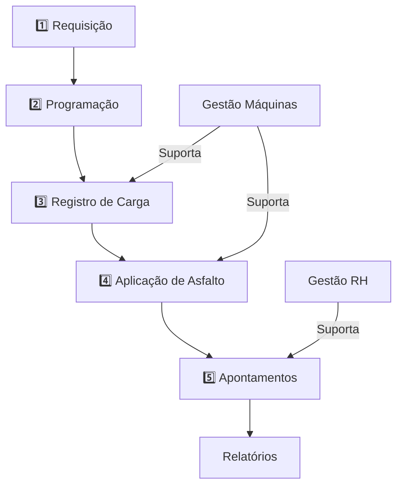

# Sistema de Gestão de Asfalto e Logística 🛣️

[](https://github.com/your-repo)
[](./CHANGELOG.md)
[](https://reactjs.org/)
[](https://www.typescriptlang.org/)
[](https://supabase.com/)
[](./LICENSE)

> **Sistema completo para gestão de aplicação de asfalto, controle de equipes, máquinas e logística operacional**

## 🚀 Quick Start

### Demo ao Vivo
- 🌐 **Demo**: [sistema-asfalto.lovable.app](https://sistema-asfalto.lovable.app)
- 👤 **Usuário Demo**: demo@sistema.com
- 🔑 **Senha**: demo123

### Instalação Local
```bash
# Clone o repositório
git clone <repository-url>
cd sistema-asfalto

# Instale as dependências
npm install

# Configure as variáveis de ambiente
cp .env.example .env
# Edite o .env com suas credenciais do Supabase

# Execute o projeto
npm run dev
```

## 📋 Visão Geral

O Sistema de Gestão de Asfalto e Logística é uma aplicação web moderna desenvolvida para **digitalizar e otimizar todo o processo de aplicação de asfalto**,  integrando gestão operacional, administrativa e financeira em uma única plataforma.

### 🎯 Objetivos

- Rastreabilidade completa do processo de aplicação
- Controle de custos e recursos operacionais
- Otimização de rotas e entregas de materiais
- Gestão eficiente de equipes e equipamentos
- Relatórios e análises em tempo real
- Conformidade com normas técnicas

### 👥 Perfis de Usuários

| Perfil | Principais Funcionalidades |
|--------|----------------------------|
| **Gestores** | Dashboard executivo, aprovações, relatórios |
| **Apontadores** | Registro de aplicações, medições, documentação |
| **Encarregados** | Gestão de equipes, avaliação de desempenho |
| **Operadores** | Controle de máquinas, chamados técnicos |
| **Administradores** | Configurações, permissões, usuários |

## 📚 Mapa da Documentação

Nossa documentação está organizada por tipo de conteúdo e público-alvo:

### 📖 Guias do Usuário
- [**Manual do Usuário**](./docs/USER_GUIDE.md) - Guia completo para usuários finais do sistema
- [**Troubleshooting**](./docs/TROUBLESHOOTING.md) - Soluções para problemas comuns

### 🛠️ Documentação Técnica
- [**Documentação Técnica**](./docs/TECHNICAL.md) - Arquitetura, padrões e implementação
- [**Banco de Dados**](./docs/DATABASE.md) - Estrutura, tabelas e relações
- [**Diagramas**](./docs/DIAGRAMS.md) - Fluxogramas e diagramas do sistema

### 👨‍💻 Desenvolvimento
- [**Guia de Desenvolvimento**](./docs/DEVELOPMENT.md) - Setup do ambiente e padrões de código
- [**CHANGELOG**](./CHANGELOG.md) - Histórico de alterações do projeto
- [**CONTRIBUTING**](./CONTRIBUTING.md) - Como contribuir para o projeto

## 🔄 Fluxo do Sistema

O sistema segue um fluxo de processo linear com cinco etapas principais:



### Processo de Aplicação de Asfalto

1. **Requisição**
   - Criação detalhada de requisições por logradouro
   - Cálculo automático de área, volume e quantidade de massa
   - Workflow de aprovações com múltiplos níveis

2. **Programação**
   - Alocação inteligente de recursos (equipes, caminhões, usinas)
   - Cronograma de entregas otimizado
   - Planejamento de rotas eficientes

3. **Registro de Cargas**
   - Controle de saída de usinas com temperaturas e pesagens
   - Documentação fotográfica completa de tickets
   - Validações de temperatura e peso

4. **Aplicação**
   - Registro preciso da chegada e aplicação em campo
   - Cálculos automáticos de espessura e área
   - Controle granular de massa remanescente
   - Múltiplas aplicações por carga

5. **Apontamentos**
   - Registro de presença e produtividade das equipes
   - Controle de uso e manutenção de equipamentos
   - Documentação de ocorrências e anomalias

## 🏗️ Arquitetura do Sistema

### Stack Tecnológico

#### Frontend
- **React 18** - Interface de usuário moderna
- **TypeScript** - Tipagem estática robusta
- **Vite** - Build tool otimizado
- **Tailwind CSS** - Design system flexível
- **Shadcn/UI** - Componentes de interface acessíveis
- **React Query** - Gerenciamento de estado do servidor
- **Recharts** - Visualização de dados e dashboards

#### Backend/Database
- **Supabase** - Backend-as-a-Service
- **PostgreSQL** - Sistema de banco de dados relacional
- **Row Level Security (RLS)** - Segurança por linha
- **Edge Functions** - Funções serverless
- **Realtime** - Updates em tempo real

### Estrutura do Projeto
```
src/
├── components/    # Componentes React organizados por domínio
├── hooks/         # Hooks personalizados 
├── services/      # Serviços de API e integrações
├── utils/         # Funções utilitárias
├── validations/   # Schemas de validação
└── pages/         # Páginas da aplicação
```

## 📈 Roadmap

### Versão 2.1 (Atual)
- ✅ Correção de formatação de datas com timezone brasileiro
- ✅ Cálculo preciso de espessura média por carga
- ✅ Interface responsiva para dispositivos móveis
- ✅ Simplificação do processo de registro de aplicação
- ✅ Melhor visualização de progresso de aplicação

### Próximas Versões
- 🔄 **Versão 2.2** (Q3 2025)
  - Módulo de gestão financeira
  - Integração com sistemas de GPS
  - Dashboard personalizado por usuário
  
- 🔄 **Versão 3.0** (Q4 2025)
  - App mobile para apontamento em campo
  - Sistema de notificações push
  - BI avançado com relatórios personalizáveis
  - API pública para integrações de terceiros

## 👥 Guia por Perfil de Usuário

### Para Desenvolvedores
1. Leia o [Guia de Desenvolvimento](./docs/DEVELOPMENT.md)
2. Consulte a [Documentação Técnica](./docs/TECHNICAL.md) 
3. Entenda o [Modelo de Dados](./docs/DATABASE.md)

### Para Usuários Finais
1. Consulte o [Manual do Usuário](./docs/USER_GUIDE.md)
2. Veja o guia de [Troubleshooting](./docs/TROUBLESHOOTING.md)
3. Entre em contato com suporte para treinamento

### Para Administradores
1. Configure permissões no módulo de Administração
2. Gerencie usuários e níveis de acesso
3. Monitore logs de sistema e auditoria

## 🚀 Deployment

### Ambientes
- **Desenvolvimento**: dev-asfalto.lovable.app
- **Homologação**: homolog-asfalto.lovable.app
- **Produção**: sistema-asfalto.lovable.app

### Requisitos de Sistema
- Node.js 18+
- NPM ou Yarn
- PostgreSQL 14+
- 2GB RAM mínimo
- SSL configurado

### Configurações de Produção
Configure as variáveis de ambiente conforme documentado em `.env.example`:
- `VITE_SUPABASE_URL`: URL do projeto Supabase
- `VITE_SUPABASE_ANON_KEY`: Chave anônima do Supabase
- `VITE_API_URL`: URL da API em produção
- `VITE_GOOGLE_MAPS_KEY`: Chave de API do Google Maps (opcional)

## 🤝 Contribuição

Contribuições são bem-vindas! Siga estes passos:

1. Faça um fork do projeto
2. Crie uma branch para sua feature: `git checkout -b feature/nova-funcionalidade`
3. Commit suas mudanças: `git commit -m 'Add: Nova funcionalidade'`
4. Push para a branch: `git push origin feature/nova-funcionalidade`
5. Abra um Pull Request

### Padrões de Código
- Seguimos o [Airbnb JavaScript Style Guide](https://github.com/airbnb/javascript)
- Utilizamos ESLint e Prettier para formatação consistente
- Todos os componentes devem ser tipados com TypeScript
- Testes unitários são necessários para novas features

## 📞 Suporte

Para suporte técnico ou dúvidas sobre o sistema:

- **Email**: suporte@sistema-asfalto.com
- **WhatsApp**: (11) 99999-9999
- **Site**: [sistema-asfalto.com/suporte](https://sistema-asfalto.com/suporte)
- **Horário de Atendimento**: Segunda a Sexta, 8h às 18h

## 📝 Licença

Este projeto está sob a licença MIT. Veja o arquivo [LICENSE](./LICENSE) para mais detalhes.

---

**Desenvolvido com ❤️ para otimizar a gestão de aplicação de asfalto**

