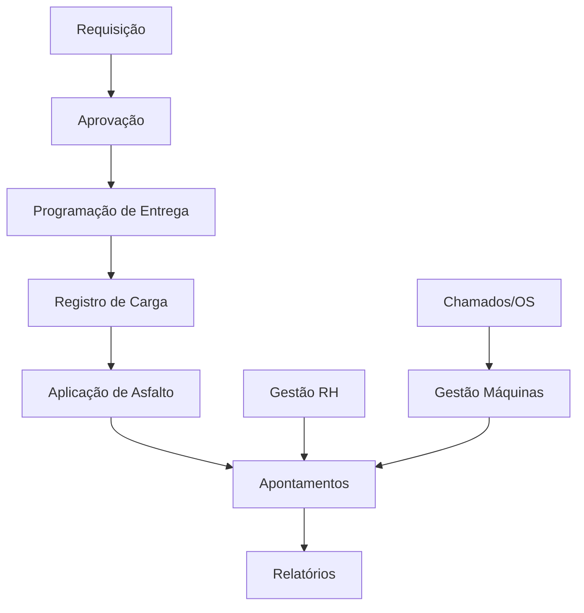

# Sistema de Gestão de Asfalto e Logística 🛣️

> Sistema completo para gestão de aplicação de asfalto, controle de equipes, máquinas e logística operacional

## 📋 Visão Geral

O Sistema de Gestão de Asfalto e Logística é uma aplicação web desenvolvida para otimizar e controlar todo o processo de aplicação de asfalto, desde a requisição inicial até o apontamento final da aplicação. O sistema integra gestão de recursos humanos, controle de máquinas, logística de entregas e apontamentos operacionais.

### 🎯 Objetivo

Digitalizar e automatizar o controle de aplicação de asfalto, proporcionando:
- Rastreabilidade completa do processo
- Controle de custos e recursos
- Otimização de rotas e entregas
- Gestão eficiente de equipes e equipamentos
- Relatórios e análises em tempo real

### 👥 Público-Alvo

- **Gestores de Obra**: Controle macro dos projetos
- **Apontadores**: Registro de aplicações e medições
- **Encarregados**: Gestão de equipes
- **Operadores**: Controle de máquinas e equipamentos
- **Administradores**: Configuração e permissões do sistema

## 🚀 Principais Funcionalidades

### 📊 Dashboard Executivo
- Indicadores de performance (KPIs)
- Gráficos de produtividade
- Status de entregas em tempo real
- Alertas e notificações

### 👥 Gestão de Recursos Humanos
- Cadastro completo de funcionários
- Controle de equipes
- Gestão de funções e permissões
- Apontamento de presença
- Avaliação de desempenho

### 🚛 Gestão de Máquinas e Equipamentos
- Cadastro de veículos e equipamentos
- Controle de manutenção
- Apontamento de uso
- Ordens de serviço
- Chamados técnicos

### 📋 Gestão de Requisições
- Criação de requisições de obra
- Aprovação de demandas
- Controle de centros de custo
- Programação de entregas

### 🛣️ Logística e Aplicação
- Programação de entregas
- Registro de cargas
- Controle de aplicação de asfalto
- Medições e cálculos automáticos
- Fotos e documentação

### 📈 Relatórios e Análises
- Relatórios de produtividade
- Medições de aplicação
- Controle de custos
- Exportação para Excel
- Análises comparativas

## 🔄 Fluxo Macro do Sistema



### 1️⃣ **Requisição**
- Engenheiro cria requisição especificando logradouros e volumes
- Sistema calcula área, volume e quantidade de massa necessária
- Aprovação por níveis hierárquicos

### 2️⃣ **Programação**
- Alocação de recursos (equipes, caminhões, usinas)
- Definição de cronograma de entregas
- Otimização de rotas

### 3️⃣ **Registro de Cargas**
- Controle de saída da usina
- Pesagem e temperatura
- Documentação fotográfica

### 4️⃣ **Aplicação**
- Chegada no local da obra
- Aplicação do asfalto com medições precisas
- Cálculo automático de espessura e área
- Controle de massa remanescente

### 5️⃣ **Apontamentos**
- Registro de presença das equipes
- Apontamento de uso de equipamentos
- Avaliação de performance
- Documentação de ocorrências

## 🛠️ Tecnologias Utilizadas

### Frontend
- **React 18** - Interface de usuário
- **TypeScript** - Tipagem estática
- **Vite** - Build tool e dev server
- **Tailwind CSS** - Estilização
- **Shadcn/UI** - Componentes de interface
- **React Hook Form** - Gerenciamento de formulários
- **React Query** - Gerenciamento de estado servidor
- **React Router** - Navegação
- **Lucide React** - Ícones
- **Recharts** - Gráficos e dashboards

### Backend/Database
- **Supabase** - Backend as a Service
- **PostgreSQL** - Banco de dados
- **Row Level Security (RLS)** - Segurança
- **Edge Functions** - Funções serverless
- **Realtime** - Atualizações em tempo real

### Bibliotecas Auxiliares
- **Zod** - Validação de schemas
- **Date-fns** - Manipulação de datas
- **Papa Parse** - Importação CSV
- **XLSX** - Exportação Excel
- **React Perfect Scrollbar** - Scroll customizado

## 📁 Estrutura do Projeto

```
src/
├── components/          # Componentes reutilizáveis
│   ├── ui/             # Componentes base (shadcn/ui)
│   ├── layout/         # Layout e navegação
│   ├── dashboard/      # Componentes do dashboard
│   ├── funcionarios/   # Gestão de RH
│   ├── veiculos/       # Gestão de máquinas
│   ├── requisicoes/    # Gestão de requisições
│   ├── programacao/    # Programação de entregas
│   ├── registro-cargas/ # Registro de cargas
│   └── registro-aplicacao/ # Aplicação de asfalto
├── hooks/              # Hooks personalizados
├── services/           # Serviços e APIs
├── types/              # Definições de tipos
├── utils/              # Funções utilitárias
├── validations/        # Schemas de validação
└── pages/              # Páginas da aplicação
```

## 🚀 Instalação e Configuração

### Pré-requisitos
- Node.js 18+ 
- npm ou yarn
- Conta no Supabase

### Passos para Instalação

1. **Clone o repositório**
```bash
git clone <repository-url>
cd sistema-asfalto
```

2. **Instale as dependências**
```bash
npm install
```

3. **Configure as variáveis de ambiente**
```bash
cp .env.example .env
```

Edite o arquivo `.env` com suas credenciais do Supabase:
```env
VITE_SUPABASE_URL=sua_url_do_supabase
VITE_SUPABASE_ANON_KEY=sua_chave_anonima
```

4. **Execute o projeto**
```bash
npm run dev
```

5. **Acesse a aplicação**
```
http://localhost:5173
```

## 📚 Documentação Adicional

- [📖 Documentação Técnica](./docs/TECHNICAL.md)
- [🗄️ Banco de Dados](./docs/DATABASE.md)
- [👨‍💻 Manual do Usuário](./docs/USER_GUIDE.md)
- [⚙️ Guia de Desenvolvimento](./docs/DEVELOPMENT.md)
- [🔧 Troubleshooting](./docs/TROUBLESHOOTING.md)

## 🤝 Contribuição

1. Fork o projeto
2. Crie uma branch para sua feature (`git checkout -b feature/nova-funcionalidade`)
3. Commit suas mudanças (`git commit -m 'Add: Nova funcionalidade'`)
4. Push para a branch (`git push origin feature/nova-funcionalidade`)
5. Abra um Pull Request

## 📝 Licença

Este projeto está sob a licença MIT. Veja o arquivo [LICENSE](./LICENSE) para mais detalhes.

## 📞 Suporte

Para suporte técnico ou dúvidas sobre o sistema:
- 📧 Email: suporte@sistema-asfalto.com
- 📱 WhatsApp: (11) 99999-9999
- 🌐 Site: https://sistema-asfalto.com

---

**Desenvolvido com ❤️ para otimizar a gestão de aplicação de asfalto**
