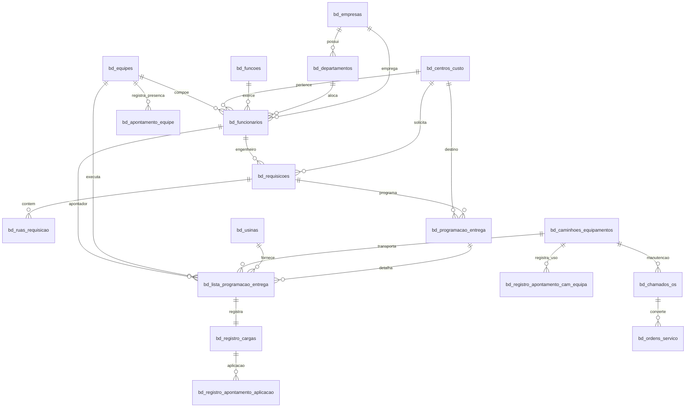

# Documentação do Banco de Dados 🗄️

## Visão Geral

O sistema utiliza PostgreSQL via Supabase com Row Level Security (RLS) habilitado para garantir segurança dos dados. O banco é estruturado em módulos funcionais que espelham a organização do sistema.

## Diagrama Entidade-Relacionamento



## Tabelas Principais

### 1. Gestão de Empresas e Organização

#### `bd_empresas`
Cadastro de empresas do sistema.

| Campo | Tipo | Descrição | Constraints |
|-------|------|-----------|-------------|
| id | UUID | Chave primária | PRIMARY KEY, DEFAULT gen_random_uuid() |
| nome_empresa | TEXT | Nome da empresa | NOT NULL |
| cnpj | TEXT | CNPJ da empresa | NOT NULL, UNIQUE |
| telefone | TEXT | Telefone de contato | - |
| situacao | VARCHAR | Status da empresa | DEFAULT 'Ativo' |
| created_at | TIMESTAMP | Data de criação | DEFAULT now() |
| updated_at | TIMESTAMP | Data de atualização | DEFAULT now() |

**Regras de Negócio:**
- CNPJ deve ser único no sistema
- Situação pode ser: 'Ativo', 'Inativo'

#### `bd_departamentos`
Departamentos organizacionais por empresa.

| Campo | Tipo | Descrição | Constraints |
|-------|------|-----------|-------------|
| id | UUID | Chave primária | PRIMARY KEY, DEFAULT gen_random_uuid() |
| nome_departamento | TEXT | Nome do departamento | NOT NULL |
| empresa_id | UUID | Referência à empresa | FOREIGN KEY → bd_empresas(id) |
| created_at | TIMESTAMP | Data de criação | DEFAULT now() |
| updated_at | TIMESTAMP | Data de atualização | DEFAULT now() |

#### `bd_centros_custo`
Centros de custo para controle financeiro.

| Campo | Tipo | Descrição | Constraints |
|-------|------|-----------|-------------|
| id | UUID | Chave primária | PRIMARY KEY, DEFAULT gen_random_uuid() |
| nome_centro_custo | TEXT | Nome do centro de custo | NOT NULL |
| codigo_centro_custo | TEXT | Código identificador | NOT NULL, UNIQUE |
| cnpj_vinculado | TEXT | CNPJ vinculado | - |
| telefone | TEXT | Telefone de contato | - |
| situacao | VARCHAR | Status do centro | DEFAULT 'Ativo' |
| created_at | TIMESTAMP | Data de criação | DEFAULT now() |
| updated_at | TIMESTAMP | Data de atualização | DEFAULT now() |

### 2. Gestão de Recursos Humanos

#### `bd_funcoes`
Funções/cargos disponíveis no sistema.

| Campo | Tipo | Descrição | Constraints |
|-------|------|-----------|-------------|
| id | UUID | Chave primária | PRIMARY KEY, DEFAULT gen_random_uuid() |
| nome_funcao | TEXT | Nome da função | NOT NULL |
| created_at | TIMESTAMP | Data de criação | DEFAULT now() |
| updated_at | TIMESTAMP | Data de atualização | DEFAULT now() |

#### `bd_funcionarios`
Cadastro completo de funcionários.

| Campo | Tipo | Descrição | Constraints |
|-------|------|-----------|-------------|
| id | UUID | Chave primária | PRIMARY KEY, DEFAULT gen_random_uuid() |
| nome_completo | TEXT | Nome completo | NOT NULL |
| cpf | TEXT | CPF do funcionário | NOT NULL, UNIQUE |
| email | TEXT | Email de contato | - |
| genero | TEXT | Gênero | - |
| data_nascimento | DATE | Data de nascimento | - |
| endereco_completo | TEXT | Endereço completo | - |
| escolaridade | TEXT | Nível de escolaridade | - |
| empresa_id | UUID | Empresa vinculada | FOREIGN KEY → bd_empresas(id) |
| departamento_id | UUID | Departamento vinculado | FOREIGN KEY → bd_departamentos(id) |
| funcao_id | UUID | Função exercida | FOREIGN KEY → bd_funcoes(id) |
| centro_custo_id | UUID | Centro de custo | FOREIGN KEY → bd_centros_custo(id) |
| equipe_id | UUID | Equipe vinculada | FOREIGN KEY → bd_equipes(id) |
| data_admissao | DATE | Data de admissão | - |
| data_demissao | DATE | Data de demissão | - |
| data_ferias | DATE | Data das férias | - |
| status | TEXT | Status do funcionário | - |
| salario_base | NUMERIC | Salário base | - |
| gratificacao | NUMERIC | Gratificação | - |
| insalubridade | NUMERIC | Adicional insalubridade | - |
| periculosidade | NUMERIC | Adicional periculosidade | - |
| adicional_noturno | NUMERIC | Adicional noturno | - |
| diarias | NUMERIC | Valor das diárias | - |
| refeicao | NUMERIC | Valor da refeição | - |
| custo_passagem | NUMERIC | Custo da passagem | - |
| imagem | TEXT | URL da foto | - |
| created_at | TIMESTAMP | Data de criação | DEFAULT now() |
| updated_at | TIMESTAMP | Data de atualização | DEFAULT now() |

**Regras de Negócio:**
- CPF deve ser único
- Data de demissão deve ser posterior à admissão
- Status pode ser: 'Ativo', 'Férias', 'Afastado', 'Demitido'

#### `bd_equipes`
Equipes de trabalho.

| Campo | Tipo | Descrição | Constraints |
|-------|------|-----------|-------------|
| id | UUID | Chave primária | PRIMARY KEY, DEFAULT gen_random_uuid() |
| nome_equipe | TEXT | Nome da equipe | NOT NULL |
| encarregado_id | UUID | Encarregado da equipe | FOREIGN KEY → bd_funcionarios(id) |
| apontador_id | UUID | Apontador da equipe | FOREIGN KEY → bd_funcionarios(id) |
| equipe | UUID[] | Array de funcionários | DEFAULT '{}' |
| created_at | TIMESTAMP | Data de criação | DEFAULT now() |
| updated_at | TIMESTAMP | Data de atualização | DEFAULT now() |

### 3. Gestão de Máquinas e Equipamentos

#### `bd_caminhoes_equipamentos`
Cadastro de veículos e equipamentos.

| Campo | Tipo | Descrição | Constraints |
|-------|------|-----------|-------------|
| id | UUID | Chave primária | PRIMARY KEY, DEFAULT gen_random_uuid() |
| placa | TEXT | Placa do veículo | - |
| tipo_veiculo | TEXT | Tipo do veículo | - |
| marca | TEXT | Marca | - |
| modelo | TEXT | Modelo | - |
| ano_fabricacao | TEXT | Ano de fabricação | - |
| cor | TEXT | Cor do veículo | - |
| numero_frota | TEXT | Número da frota | - |
| frota | TEXT | Código da frota | - |
| capacidade | TEXT | Capacidade de carga | - |
| motor | TEXT | Especificação do motor | - |
| tipo_combustivel | TEXT | Tipo de combustível | - |
| situacao | TEXT | Situação atual | - |
| status_ipva | TEXT | Status do IPVA | - |
| aluguel | TEXT | Status de aluguel | - |
| empresa_id | UUID | Empresa proprietária | FOREIGN KEY → bd_empresas(id) |
| departamento_id | UUID | Departamento responsável | FOREIGN KEY → bd_departamentos(id) |
| imagem_url | TEXT | URL da imagem | - |
| observacoes | TEXT | Observações gerais | - |
| created_at | TIMESTAMP | Data de criação | DEFAULT now() |
| updated_at | TIMESTAMP | Data de atualização | DEFAULT now() |

**Regras de Negócio:**
- Situação pode ser: 'Disponível', 'Em Uso', 'Manutenção', 'Indisponível'
- Tipo de veículo: 'Caminhão', 'Trator', 'Equipamento', etc.

### 4. Gestão de Usinas

#### `bd_usinas`
Cadastro de usinas fornecedoras de asfalto.

| Campo | Tipo | Descrição | Constraints |
|-------|------|-----------|-------------|
| id | UUID | Chave primária | PRIMARY KEY, DEFAULT gen_random_uuid() |
| nome_usina | TEXT | Nome da usina | NOT NULL |
| endereco | TEXT | Endereço completo | - |
| telefone | TEXT | Telefone de contato | - |
| producao_total | NUMERIC | Produção total | - |
| created_at | TIMESTAMP | Data de criação | DEFAULT now() |
| updated_at | TIMESTAMP | Data de atualização | DEFAULT now() |

### 5. Gestão de Requisições

#### `bd_requisicoes`
Requisições de obras de asfalto.

| Campo | Tipo | Descrição | Constraints |
|-------|------|-----------|-------------|
| id | UUID | Chave primária | PRIMARY KEY, DEFAULT gen_random_uuid() |
| numero | TEXT | Número da requisição | NOT NULL, UNIQUE |
| centro_custo_id | UUID | Centro de custo solicitante | FOREIGN KEY → bd_centros_custo(id) |
| diretoria | TEXT | Diretoria responsável | - |
| gerencia | TEXT | Gerência responsável | - |
| engenheiro_id | UUID | Engenheiro responsável | FOREIGN KEY → bd_funcionarios(id) |
| data_requisicao | DATE | Data da requisição | DEFAULT CURRENT_DATE |
| created_at | TIMESTAMP | Data de criação | DEFAULT now() |
| updated_at | TIMESTAMP | Data de atualização | DEFAULT now() |

#### `bd_ruas_requisicao`
Logradouros específicos de cada requisição.

| Campo | Tipo | Descrição | Constraints |
|-------|------|-----------|-------------|
| id | UUID | Chave primária | PRIMARY KEY, DEFAULT gen_random_uuid() |
| requisicao_id | UUID | Referência à requisição | FOREIGN KEY → bd_requisicoes(id) |
| logradouro | TEXT | Nome do logradouro | NOT NULL |
| bairro | TEXT | Bairro do logradouro | - |
| largura | NUMERIC | Largura da via (m) | NOT NULL |
| comprimento | NUMERIC | Comprimento da via (m) | NOT NULL |
| area | NUMERIC | Área calculada (m²) | COMPUTED: largura * comprimento |
| pintura_ligacao | TEXT | Tipo de pintura/ligação | NOT NULL |
| traco | TEXT | Traço do asfalto | NOT NULL |
| espessura | NUMERIC | Espessura prevista (cm) | NOT NULL |
| volume | NUMERIC | Volume calculado (m³) | COMPUTED: area * espessura / 100 |
| created_at | TIMESTAMP | Data de criação | DEFAULT now() |
| updated_at | TIMESTAMP | Data de atualização | DEFAULT now() |

**Regras de Negócio:**
- Área = largura × comprimento
- Volume = área × espessura ÷ 100
- Massa estimada = volume × densidade (2,4 t/m³)

### 6. Programação de Entregas

#### `bd_programacao_entrega`
Programação macro de entregas.

| Campo | Tipo | Descrição | Constraints |
|-------|------|-----------|-------------|
| id | UUID | Chave primária | PRIMARY KEY, DEFAULT gen_random_uuid() |
| requisicao_id | UUID | Requisição base | FOREIGN KEY → bd_requisicoes(id) |
| centro_custo_id | UUID | Centro de custo | FOREIGN KEY → bd_centros_custo(id) |
| data_entrega | DATE | Data programada | NOT NULL |
| created_at | TIMESTAMP | Data de criação | DEFAULT now() |
| updated_at | TIMESTAMP | Data de atualização | DEFAULT now() |

#### `bd_lista_programacao_entrega`
Detalhamento específico de cada entrega.

| Campo | Tipo | Descrição | Constraints |
|-------|------|-----------|-------------|
| id | UUID | Chave primária | PRIMARY KEY, DEFAULT gen_random_uuid() |
| programacao_entrega_id | UUID | Programação macro | FOREIGN KEY → bd_programacao_entrega(id) |
| requisicao_id | UUID | Requisição base | FOREIGN KEY → bd_requisicoes(id) |
| usina_id | UUID | Usina fornecedora | FOREIGN KEY → bd_usinas(id) |
| apontador_id | UUID | Apontador responsável | FOREIGN KEY → bd_funcionarios(id) |
| equipe_id | UUID | Equipe executora | FOREIGN KEY → bd_equipes(id) |
| caminhao_id | UUID | Caminhão transportador | FOREIGN KEY → bd_caminhoes_equipamentos(id) |
| data_entrega | DATE | Data da entrega | DEFAULT CURRENT_DATE |
| logradouro | TEXT | Logradouro da entrega | NOT NULL |
| quantidade_massa | NUMERIC | Quantidade de massa (t) | NOT NULL |
| tipo_lancamento | TEXT | Tipo de lançamento | NOT NULL |
| status | TEXT | Status da entrega | DEFAULT 'Ativa' |
| programacao_id | UUID | ID adicional de programação | - |
| created_at | TIMESTAMP | Data de criação | DEFAULT now() |
| updated_at | TIMESTAMP | Data de atualização | DEFAULT now() |

**Regras de Negócio:**
- Status: 'Ativa', 'Enviada', 'Entregue', 'Cancelada'
- Tipo de lançamento: 'Recapeamento', 'Tapa Buraco', 'Pavimentação Nova'

### 7. Registro de Cargas

#### `bd_registro_cargas`
Controle de cargas de asfalto da usina.

| Campo | Tipo | Descrição | Constraints |
|-------|------|-----------|-------------|
| id | UUID | Chave primária | PRIMARY KEY, DEFAULT gen_random_uuid() |
| lista_entrega_id | UUID | Entrega correspondente | FOREIGN KEY → bd_lista_programacao_entrega(id) |
| programacao_id | UUID | Programação relacionada | FOREIGN KEY → bd_programacao_entrega(id) |
| data_saida | DATE | Data de saída da usina | NOT NULL |
| hora_saida | TIME | Hora de saída | NOT NULL |
| temperatura_saida | NUMERIC | Temperatura na saída (°C) | - |
| tonelada_saida | NUMERIC | Peso na saída (t) | NOT NULL |
| imagem_ticket_saida | TEXT | Foto do ticket de saída | NOT NULL |
| tonelada_retorno | NUMERIC | Peso no retorno (t) | - |
| imagem_ticket_retorno | TEXT | Foto do ticket de retorno | - |
| tonelada_real | NUMERIC | Peso real transportado | COMPUTED: tonelada_saida - tonelada_retorno |
| status_registro | TEXT | Status do registro | DEFAULT 'Ativo' |

**Regras de Negócio:**
- Tonelada real = tonelada_saida - tonelada_retorno
- Status: 'Ativo', 'Cancelado', 'Concluído'
- Temperatura deve estar entre 120°C e 180°C

### 8. Registro de Aplicação

#### `bd_registro_apontamento_aplicacao`
Registro principal da aplicação de asfalto.

| Campo | Tipo | Descrição | Constraints |
|-------|------|-----------|-------------|
| id | UUID | Chave primária | PRIMARY KEY, DEFAULT gen_random_uuid() |
| lista_entrega_id | UUID | Entrega relacionada | FOREIGN KEY → bd_lista_programacao_entrega(id) |
| registro_carga_id | UUID | Carga relacionada | FOREIGN KEY → bd_registro_cargas(id) |
| logradouro_id | UUID | Logradouro aplicado | - |
| logradouro_aplicado | TEXT | Nome do logradouro | - |
| data_aplicacao | DATE | Data da aplicação | NOT NULL |
| hora_chegada_local | TIME | Hora de chegada | NOT NULL |
| temperatura_chegada | NUMERIC | Temperatura na chegada (°C) | - |
| hora_aplicacao | TIME | Hora de início da aplicação | - |
| temperatura_aplicacao | NUMERIC | Temperatura na aplicação (°C) | - |
| bordo | TEXT | Bordo aplicado | - |
| estaca_inicial | NUMERIC | Estaca inicial | - |
| comprimento | NUMERIC | Comprimento aplicado (m) | - |
| largura_media | NUMERIC | Largura média (m) | - |
| area | NUMERIC | Área aplicada (m²) | - |
| area_calculada | NUMERIC | Área calculada automaticamente | COMPUTED: comprimento * largura_media |
| tonelada_aplicada | NUMERIC | Massa aplicada (t) | - |
| espessura | NUMERIC | Espessura aplicada (cm) | - |
| espessura_calculada | NUMERIC | Espessura calculada | COMPUTED: (tonelada_aplicada / area) / 2.4 * 100 |
| hora_saida_caminhao | TIME | Hora de saída do caminhão | - |
| estaca_final | NUMERIC | Estaca final | - |
| anotacoes_apontador | TEXT | Observações do apontador | - |
| usar_massa_total_para_espessura | BOOLEAN | Usar massa total no cálculo | DEFAULT false |
| aplicacao_sequencia | INTEGER | Sequência da aplicação | DEFAULT 1 |
| media_espessura_cm | NUMERIC | Média de espessura | - |
| carga_finalizada | BOOLEAN | Carga finalizada | DEFAULT false |
| massa_remanescente_antes_aplicacao | NUMERIC | Massa remanescente anterior | - |
| carga_origem_id | UUID | ID da carga origem | - |
| status_aplicacao | TEXT | Status da aplicação | DEFAULT 'Em Andamento' |
| percentual_aplicado | NUMERIC | Percentual aplicado | DEFAULT 0 |
| carga_total_aplicada | NUMERIC | Total aplicado da carga | DEFAULT 0 |
| observacoes_gerais | TEXT | Observações gerais | - |
| data_inicio_aplicacao | TIMESTAMP | Início da aplicação | DEFAULT now() |
| data_fim_aplicacao | TIMESTAMP | Fim da aplicação | - |
| created_by | UUID | Criado por | - |
| created_at | TIMESTAMP | Data de criação | DEFAULT now() |
| updated_at | TIMESTAMP | Data de atualização | DEFAULT now() |

**Regras de Negócio:**
- Área calculada = comprimento × largura_media
- Espessura calculada = (tonelada_aplicada ÷ area) ÷ 2,4 × 100
- Status: 'Iniciada', 'Em Andamento', 'Finalizada'
- Bordo: 'Direito', 'Esquerdo', 'Centro', 'Único', 'Embocadura'

#### `bd_registro_aplicacao_detalhes`
Detalhes específicos de cada aplicação (múltiplas aplicações por carga).

| Campo | Tipo | Descrição | Constraints |
|-------|------|-----------|-------------|
| id | UUID | Chave primária | PRIMARY KEY, DEFAULT gen_random_uuid() |
| registro_aplicacao_id | UUID | Registro principal | FOREIGN KEY → bd_registro_apontamento_aplicacao(id) |
| lista_entrega_id | UUID | Entrega relacionada | FOREIGN KEY → bd_lista_programacao_entrega(id) |
| registro_carga_id | UUID | Carga relacionada | FOREIGN KEY → bd_registro_cargas(id) |
| logradouro_id | UUID | Logradouro aplicado | - |
| logradouro_nome | TEXT | Nome do logradouro | NOT NULL |
| sequencia_aplicacao | INTEGER | Sequência da aplicação | DEFAULT 1 |
| data_aplicacao | DATE | Data da aplicação | DEFAULT CURRENT_DATE |
| area_aplicada | NUMERIC | Área aplicada (m²) | NOT NULL |
| tonelada_aplicada | NUMERIC | Massa aplicada (t) | NOT NULL |
| comprimento | NUMERIC | Comprimento (m) | - |
| largura_media | NUMERIC | Largura média (m) | - |
| espessura_aplicada | NUMERIC | Espessura aplicada (cm) | - |
| espessura_calculada | NUMERIC | Espessura calculada | - |
| bordo | TEXT | Bordo aplicado | - |
| estaca_inicial | NUMERIC | Estaca inicial | - |
| estaca_final | NUMERIC | Estaca final | - |
| temperatura_aplicacao | NUMERIC | Temperatura na aplicação | - |
| hora_inicio_aplicacao | TIME | Hora de início | - |
| hora_fim_aplicacao | TIME | Hora de fim | - |
| equipamento_compactacao | TEXT | Equipamento usado | - |
| numero_passadas | INTEGER | Número de passadas | - |
| densidade_compactacao | NUMERIC | Densidade de compactação | - |
| condicoes_climaticas | TEXT | Condições do tempo | - |
| fotos_aplicacao | TEXT[] | URLs das fotos | - |
| observacoes_aplicacao | TEXT | Observações | - |
| created_by | UUID | Criado por | - |
| created_at | TIMESTAMP | Data de criação | DEFAULT now() |
| updated_at | TIMESTAMP | Data de atualização | DEFAULT now() |

### 9. Apontamentos de Equipe

#### `bd_apontamento_equipe`
Controle de presença e performance das equipes.

| Campo | Tipo | Descrição | Constraints |
|-------|------|-----------|-------------|
| id | UUID | Chave primária | PRIMARY KEY, DEFAULT gen_random_uuid() |
| lista_entrega_id | UUID | Entrega relacionada | FOREIGN KEY → bd_lista_programacao_entrega(id) |
| data_registro | DATE | Data do apontamento | NOT NULL |
| equipe_id | UUID | Equipe apontada | FOREIGN KEY → bd_equipes(id) |
| colaborador_id | UUID | Colaborador apontado | FOREIGN KEY → bd_funcionarios(id) |
| nome_colaborador | TEXT | Nome do colaborador | NOT NULL |
| hora_inicio | TIME | Hora de início | - |
| hora_fim | TIME | Hora de fim | - |
| presente | BOOLEAN | Presente no dia | DEFAULT false |
| registrado_por | UUID | Quem registrou | FOREIGN KEY → bd_funcionarios(id) |
| created_at | TIMESTAMP | Data de criação | DEFAULT now() |
| updated_at | TIMESTAMP | Data de atualização | DEFAULT now() |

#### `bd_avaliacao_equipe`
Avaliação de performance dos colaboradores.

| Campo | Tipo | Descrição | Constraints |
|-------|------|-----------|-------------|
| id | UUID | Chave primária | PRIMARY KEY, DEFAULT gen_random_uuid() |
| colaborador_id | UUID | Colaborador avaliado | FOREIGN KEY → bd_funcionarios(id) |
| equipe_id | UUID | Equipe do colaborador | FOREIGN KEY → bd_equipes(id) |
| data_avaliacao | DATE | Data da avaliação | NOT NULL |
| competencia_tecnica | INTEGER | Nota competência técnica | CHECK (competencia_tecnica BETWEEN 1 AND 5) |
| comunicacao | INTEGER | Nota comunicação | CHECK (comunicacao BETWEEN 1 AND 5) |
| trabalho_em_equipe | INTEGER | Nota trabalho em equipe | CHECK (trabalho_em_equipe BETWEEN 1 AND 5) |
| proatividade | INTEGER | Nota proatividade | CHECK (proatividade BETWEEN 1 AND 5) |
| pontualidade | INTEGER | Nota pontualidade | CHECK (pontualidade BETWEEN 1 AND 5) |
| organizacao | INTEGER | Nota organização | CHECK (organizacao BETWEEN 1 AND 5) |
| anotacoes | TEXT | Observações da avaliação | - |
| criado_por | UUID | Avaliador | FOREIGN KEY → bd_funcionarios(id) |
| created_at | TIMESTAMP | Data de criação | DEFAULT now() |

### 10. Apontamento de Máquinas

#### `bd_registro_apontamento_cam_equipa`
Apontamento de uso de caminhões e equipamentos.

| Campo | Tipo | Descrição | Constraints |
|-------|------|-----------|-------------|
| id | UUID | Chave primária | PRIMARY KEY, DEFAULT gen_random_uuid() |
| data | DATE | Data do apontamento | DEFAULT CURRENT_DATE |
| caminhao_equipamento_id | UUID | Máquina apontada | FOREIGN KEY → bd_caminhoes_equipamentos(id) |
| operador_id | UUID | Operador da máquina | FOREIGN KEY → bd_funcionarios(id) |
| centro_custo_id | UUID | Centro de custo | FOREIGN KEY → bd_centros_custo(id) |
| hora_inicial | TIME | Hora de início | - |
| hora_final | TIME | Hora de fim | - |
| horimetro_inicial | NUMERIC | Horímetro inicial | - |
| horimetro_final | NUMERIC | Horímetro final | - |
| abastecimento | NUMERIC | Litros abastecidos | - |
| situacao | TEXT | Situação da máquina | - |
| created_at | TIMESTAMP | Data de criação | DEFAULT now() |
| updated_at | TIMESTAMP | Data de atualização | DEFAULT now() |

### 11. Chamados e Ordens de Serviço

#### `bd_chamados_os`
Chamados técnicos para manutenção.

| Campo | Tipo | Descrição | Constraints |
|-------|------|-----------|-------------|
| id | UUID | Chave primária | PRIMARY KEY, DEFAULT gen_random_uuid() |
| numero_chamado | TEXT | Número do chamado | NOT NULL, UNIQUE |
| data_solicitacao | DATE | Data da solicitação | DEFAULT CURRENT_DATE |
| hora_solicitacao | TIME | Hora da solicitação | DEFAULT CURRENT_TIME |
| solicitante_id | UUID | Solicitante | FOREIGN KEY → bd_funcionarios(id) |
| centro_custo_id | UUID | Centro de custo | FOREIGN KEY → bd_centros_custo(id) |
| caminhao_equipamento_id | UUID | Máquina com problema | FOREIGN KEY → bd_caminhoes_equipamentos(id) |
| tipo_falha | TEXT | Tipo da falha | - |
| descricao_problema | TEXT | Descrição do problema | - |
| prioridade | TEXT | Prioridade do chamado | - |
| status | TEXT | Status do chamado | - |
| fotos_avarias | TEXT[] | Fotos das avarias | - |
| created_at | TIMESTAMP | Data de criação | DEFAULT now() |
| updated_at | TIMESTAMP | Data de atualização | DEFAULT now() |

#### `bd_ordens_servico`
Ordens de serviço convertidas dos chamados.

| Campo | Tipo | Descrição | Constraints |
|-------|------|-----------|-------------|
| id | UUID | Chave primária | PRIMARY KEY, DEFAULT gen_random_uuid() |
| chamado_id | UUID | Chamado origem | FOREIGN KEY → bd_chamados_os(id) |
| numero_chamado | TEXT | Número do chamado | - |
| data_solicitacao | DATE | Data da solicitação | - |
| hora_solicitacao | TIME | Hora da solicitação | - |
| solicitante_id | UUID | Solicitante | FOREIGN KEY → bd_funcionarios(id) |
| centro_custo_id | UUID | Centro de custo | FOREIGN KEY → bd_centros_custo(id) |
| caminhao_equipamento_id | UUID | Máquina em manutenção | FOREIGN KEY → bd_caminhoes_equipamentos(id) |
| tipo_falha | TEXT | Tipo da falha | - |
| descricao_problema | TEXT | Descrição do problema | - |
| prioridade | TEXT | Prioridade da OS | - |
| setor | TEXT | Setor responsável | - |
| horimetro_km | NUMERIC | Horímetro/KM atual | - |
| data_inicio_atendimento | DATE | Data de início | - |
| hora_inicio_atendimento | TIME | Hora de início | - |
| data_fim_atendimento | DATE | Data de fim | - |
| hora_fim_atendimento | TIME | Hora de fim | - |
| horimetro_km_inicial | NUMERIC | Horímetro inicial | - |
| horimetro_km_final | NUMERIC | Horímetro final | - |
| duracao_servico | INTERVAL | Duração do serviço | - |
| executado_por_id | UUID | Executado por | FOREIGN KEY → bd_funcionarios(id) |
| encerrado_por_id | UUID | Encerrado por | FOREIGN KEY → bd_funcionarios(id) |
| anotacoes_internas | TEXT | Anotações internas | - |
| tratativa | TEXT | Tratativa aplicada | - |
| status | TEXT | Status da OS | DEFAULT 'Aberta' |
| fotos_avarias | TEXT[] | Fotos das avarias | - |
| created_at | TIMESTAMP | Data de criação | DEFAULT now() |
| updated_at | TIMESTAMP | Data de atualização | DEFAULT now() |

### 12. Tabelas de Apoio

#### `profiles`
Perfis de usuários do sistema (integração com Supabase Auth).

| Campo | Tipo | Descrição | Constraints |
|-------|------|-----------|-------------|
| id | UUID | Chave primária (auth.users) | PRIMARY KEY, REFERENCES auth.users |
| email | TEXT | Email do usuário | - |
| nome_completo | TEXT | Nome completo | - |
| imagem_url | TEXT | URL da foto de perfil | - |
| funcoes | TEXT[] | Funções do usuário | DEFAULT ARRAY['user'] |
| funcao_permissao | UUID | Função de permissão | FOREIGN KEY → bd_funcoes_permissao(id) |
| created_at | TIMESTAMP | Data de criação | DEFAULT now() |

#### `bd_permissoes`
Permissões do sistema.

| Campo | Tipo | Descrição | Constraints |
|-------|------|-----------|-------------|
| id | UUID | Chave primária | PRIMARY KEY, DEFAULT gen_random_uuid() |
| nome_permissao | TEXT | Nome da permissão | NOT NULL |
| descricao | TEXT | Descrição da permissão | - |
| rota | TEXT | Rota relacionada | - |
| created_at | TIMESTAMP | Data de criação | DEFAULT now() |
| updated_at | TIMESTAMP | Data de atualização | DEFAULT now() |

#### `bd_funcoes_permissao`
Agrupamento de permissões por função.

| Campo | Tipo | Descrição | Constraints |
|-------|------|-----------|-------------|
| id | UUID | Chave primária | PRIMARY KEY, DEFAULT gen_random_uuid() |
| nome_funcao | TEXT | Nome da função | NOT NULL |
| descricao | TEXT | Descrição da função | - |
| permissoes | TEXT[] | Array de permissões | - |
| created_at | TIMESTAMP | Data de criação | DEFAULT now() |
| updated_at | TIMESTAMP | Data de atualização | DEFAULT now() |

## Views e Funções

### Views Materializadas

#### `vw_entregas_com_massa_remanescente`
View que calcula automaticamente a massa remanescente de cada entrega.

```sql
CREATE VIEW vw_entregas_com_massa_remanescente AS
SELECT 
    lpe.*,
    rc.tonelada_real as massa_total_carga,
    COALESCE(SUM(raa.tonelada_aplicada), 0) as massa_aplicada_total,
    GREATEST(0, rc.tonelada_real - COALESCE(SUM(raa.tonelada_aplicada), 0)) as massa_remanescente
FROM bd_lista_programacao_entrega lpe
LEFT JOIN bd_registro_cargas rc ON lpe.id = rc.lista_entrega_id
LEFT JOIN bd_registro_apontamento_aplicacao raa ON lpe.id = raa.lista_entrega_id
GROUP BY lpe.id, rc.tonelada_real;
```

#### `vw_registro_aplicacao_completo`
View completa dos registros de aplicação com todos os relacionamentos.

```sql
CREATE VIEW vw_registro_aplicacao_completo AS
SELECT 
    ra.*,
    lpe.logradouro,
    lpe.quantidade_massa,
    lpe.tipo_lancamento,
    lpe.status as status_entrega,
    rc.tonelada_real as massa_total_carga,
    COALESCE(SUM(rad.tonelada_aplicada), 0) as total_aplicado,
    COUNT(rad.id) as numero_aplicacoes,
    COALESCE(SUM(rad.area_aplicada), 0) as area_total_aplicada,
    CASE 
        WHEN rc.tonelada_real > 0 THEN 
            (COALESCE(SUM(rad.tonelada_aplicada), 0) / rc.tonelada_real) * 100
        ELSE 0 
    END as percentual_aplicado,
    GREATEST(0, rc.tonelada_real - COALESCE(SUM(rad.tonelada_aplicada), 0)) as massa_remanescente,
    CASE 
        WHEN GREATEST(0, rc.tonelada_real - COALESCE(SUM(rad.tonelada_aplicada), 0)) <= 0.001 THEN 'Finalizada'
        WHEN COALESCE(SUM(rad.tonelada_aplicada), 0) > 0 THEN 'Em Andamento'
        ELSE 'Iniciada'
    END as status_calculado,
    CASE 
        WHEN COALESCE(SUM(rad.area_aplicada), 0) > 0 THEN 
            ROUND((COALESCE(SUM(rad.tonelada_aplicada), 0) / COALESCE(SUM(rad.area_aplicada), 1) / 2.4) * 100, 2)
        ELSE 0 
    END as espessura_media_cm
FROM bd_registro_apontamento_aplicacao ra
LEFT JOIN bd_lista_programacao_entrega lpe ON ra.lista_entrega_id = lpe.id
LEFT JOIN bd_registro_cargas rc ON ra.registro_carga_id = rc.id
LEFT JOIN bd_registro_aplicacao_detalhes rad ON ra.id = rad.registro_aplicacao_id
GROUP BY ra.id, lpe.logradouro, lpe.quantidade_massa, lpe.tipo_lancamento, lpe.status, rc.tonelada_real;
```

### Funções do Banco

#### `calcular_massa_remanescente(entrega_id UUID)`
Calcula a massa remanescente de uma entrega específica.

```sql
CREATE OR REPLACE FUNCTION calcular_massa_remanescente(entrega_id UUID)
RETURNS NUMERIC AS $$
DECLARE
    massa_total NUMERIC := 0;
    massa_aplicada NUMERIC := 0;
    massa_remanescente NUMERIC := 0;
BEGIN
    -- Buscar a massa total da carga
    SELECT rc.tonelada_real 
    INTO massa_total
    FROM bd_registro_cargas rc
    INNER JOIN bd_lista_programacao_entrega lpe ON rc.lista_entrega_id = lpe.id
    WHERE lpe.id = entrega_id;
    
    -- Se não encontrar a massa total, retornar 0
    IF massa_total IS NULL THEN
        RETURN 0;
    END IF;
    
    -- Somar todas as aplicações já realizadas para esta entrega
    SELECT COALESCE(SUM(raa.tonelada_aplicada), 0)
    INTO massa_aplicada
    FROM bd_registro_apontamento_aplicacao raa
    WHERE raa.lista_entrega_id = entrega_id;
    
    -- Calcular massa remanescente
    massa_remanescente := massa_total - massa_aplicada;
    
    -- Garantir que não seja negativo
    IF massa_remanescente < 0 THEN
        massa_remanescente := 0;
    END IF;
    
    RETURN massa_remanescente;
END;
$$ LANGUAGE plpgsql;
```

#### `calcular_media_espessura_carga(carga_id UUID)`
Calcula a média de espessura de uma carga específica.

```sql
CREATE OR REPLACE FUNCTION calcular_media_espessura_carga(carga_id UUID)
RETURNS NUMERIC AS $$
DECLARE
    massa_total NUMERIC := 0;
    soma_areas NUMERIC := 0;
    media_espessura NUMERIC := 0;
BEGIN
    -- Buscar massa total da carga
    SELECT rc.tonelada_real 
    INTO massa_total
    FROM bd_registro_cargas rc
    WHERE rc.id = carga_id;
    
    -- Somar todas as áreas aplicadas desta carga
    SELECT COALESCE(SUM(raa.area_calculada), 0)
    INTO soma_areas
    FROM bd_registro_apontamento_aplicacao raa
    WHERE raa.registro_carga_id = carga_id;
    
    -- Calcular média: massa_total / soma_areas / 2.4
    IF soma_areas > 0 AND massa_total > 0 THEN
        media_espessura := massa_total / soma_areas / 2.4;
    ELSE
        media_espessura := 0;
    END IF;
    
    RETURN media_espessura;
END;
$$ LANGUAGE plpgsql;
```

### Triggers

#### `trigger_atualizar_status_entrega`
Atualiza automaticamente o status da entrega quando há alterações.

```sql
CREATE OR REPLACE FUNCTION atualizar_status_entrega_massa_remanescente()
RETURNS TRIGGER AS $$
DECLARE
    massa_remanescente NUMERIC;
BEGIN
    -- Calcular massa remanescente para a entrega
    SELECT calcular_massa_remanescente(NEW.lista_entrega_id) INTO massa_remanescente;
    
    -- Se massa remanescente for 0, marcar entrega como 'Entregue'
    IF massa_remanescente <= 0 THEN
        UPDATE bd_lista_programacao_entrega
        SET status = 'Entregue'
        WHERE id = NEW.lista_entrega_id;
    END IF;
    
    RETURN NEW;
END;
$$ LANGUAGE plpgsql;

CREATE TRIGGER trigger_atualizar_status_entrega
    AFTER INSERT OR UPDATE ON bd_registro_apontamento_aplicacao
    FOR EACH ROW EXECUTE PROCEDURE atualizar_status_entrega_massa_remanescente();
```

#### `trigger_update_timestamp`
Atualiza automaticamente o campo `updated_at`.

```sql
CREATE OR REPLACE FUNCTION update_updated_at_column()
RETURNS TRIGGER AS $$
BEGIN
    NEW.updated_at = NOW();
    RETURN NEW;
END;
$$ LANGUAGE plpgsql;

-- Aplicar a todas as tabelas principais
CREATE TRIGGER update_funcionarios_updated_at 
    BEFORE UPDATE ON bd_funcionarios 
    FOR EACH ROW EXECUTE PROCEDURE update_updated_at_column();

CREATE TRIGGER update_veiculos_updated_at 
    BEFORE UPDATE ON bd_caminhoes_equipamentos 
    FOR EACH ROW EXECUTE PROCEDURE update_updated_at_column();

-- E assim por diante para todas as tabelas...
```

## Políticas de Segurança (RLS)

### Row Level Security

Todas as tabelas principais têm RLS habilitado com políticas específicas:

#### Exemplo: Funcionários
```sql
-- Habilitar RLS
ALTER TABLE bd_funcionarios ENABLE ROW LEVEL SECURITY;

-- Política para visualização (usuários podem ver funcionários da mesma empresa)
CREATE POLICY "Usuarios podem ver funcionarios da mesma empresa" 
ON bd_funcionarios FOR SELECT 
USING (
    empresa_id IN (
        SELECT empresa_id 
        FROM bd_funcionarios f
        INNER JOIN profiles p ON f.id = p.id
        WHERE p.id = auth.uid()
    )
);

-- Política para inserção (apenas administradores)
CREATE POLICY "Apenas admins podem inserir funcionarios" 
ON bd_funcionarios FOR INSERT 
WITH CHECK (
    auth.uid() IN (
        SELECT p.id 
        FROM profiles p 
        WHERE 'admin' = ANY(p.funcoes)
    )
);
```

#### Exemplo: Registros de Aplicação
```sql
-- Política para apontadores verem apenas suas entregas
CREATE POLICY "Apontadores veem apenas suas entregas" 
ON bd_registro_apontamento_aplicacao FOR SELECT 
USING (
    lista_entrega_id IN (
        SELECT id 
        FROM bd_lista_programacao_entrega 
        WHERE apontador_id = auth.uid()
    )
    OR
    auth.uid() IN (
        SELECT p.id 
        FROM profiles p 
        WHERE 'admin' = ANY(p.funcoes) OR 'gestor' = ANY(p.funcoes)
    )
);
```

## Índices de Performance

### Índices Principais

```sql
-- Índices para consultas frequentes
CREATE INDEX idx_funcionarios_empresa ON bd_funcionarios(empresa_id);
CREATE INDEX idx_funcionarios_departamento ON bd_funcionarios(departamento_id);
CREATE INDEX idx_funcionarios_funcao ON bd_funcionarios(funcao_id);
CREATE INDEX idx_funcionarios_status ON bd_funcionarios(status);

CREATE INDEX idx_veiculos_empresa ON bd_caminhoes_equipamentos(empresa_id);
CREATE INDEX idx_veiculos_situacao ON bd_caminhoes_equipamentos(situacao);

CREATE INDEX idx_entregas_data ON bd_lista_programacao_entrega(data_entrega);
CREATE INDEX idx_entregas_status ON bd_lista_programacao_entrega(status);
CREATE INDEX idx_entregas_apontador ON bd_lista_programacao_entrega(apontador_id);

CREATE INDEX idx_aplicacao_entrega ON bd_registro_apontamento_aplicacao(lista_entrega_id);
CREATE INDEX idx_aplicacao_carga ON bd_registro_apontamento_aplicacao(registro_carga_id);
CREATE INDEX idx_aplicacao_data ON bd_registro_apontamento_aplicacao(data_aplicacao);

-- Índices compostos para consultas complexas
CREATE INDEX idx_entregas_data_status ON bd_lista_programacao_entrega(data_entrega, status);
CREATE INDEX idx_aplicacao_entrega_data ON bd_registro_apontamento_aplicacao(lista_entrega_id, data_aplicacao);
```

## Backup e Manutenção

### Estratégia de Backup

1. **Backup Automático**: Supabase realiza backups automáticos diários
2. **Backup Manual**: Antes de mudanças críticas no schema
3. **Exportação de Dados**: Rotina semanal de exportação para arquivos

### Limpeza de Dados

```sql
-- Limpar registros antigos (executar mensalmente)
DELETE FROM bd_registro_apontamento_cam_equipa 
WHERE data < CURRENT_DATE - INTERVAL '2 years';

-- Limpar logs de auditoria antigos
DELETE FROM bd_carga_status_historico 
WHERE data_alteracao < CURRENT_DATE - INTERVAL '1 year';
```

### Monitoramento

- Queries lentas (> 1s)
- Crescimento das tabelas
- Uso de índices
- Violações de constraints
- Políticas RLS em execução

## Considerações de Performance

### Otimizações Implementadas

1. **Índices Estratégicos**: Criados com base nos padrões de consulta
2. **Views Materializadas**: Para consultas complexas frequentes
3. **Particionamento**: Tabelas de log por data
4. **Compressão**: Campos de texto grandes
5. **Archiving**: Dados antigos movidos para tabelas de arquivo

### Métricas de Performance

- Tempo médio de consulta: < 100ms
- Throughput: > 1000 ops/segundo
- Disponibilidade: 99.9%
- Latência de replicação: < 1s
