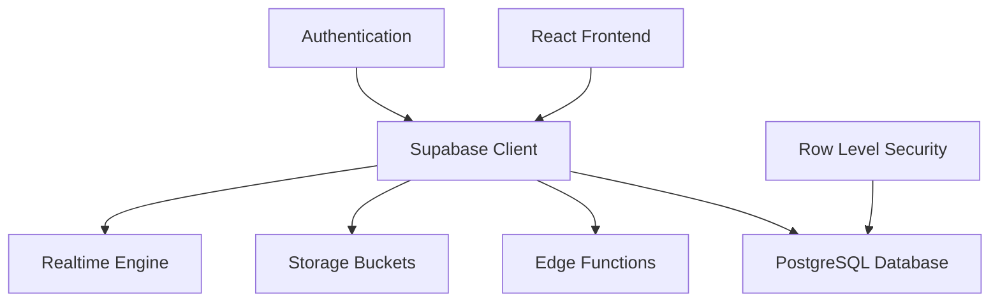

# Documentação Técnica 🛠️

## Arquitetura do Sistema

### Overview da Arquitetura

O sistema segue uma arquitetura moderna baseada em:
- **Frontend**: React SPA (Single Page Application)
- **Backend**: Supabase (PostgreSQL + Edge Functions)
- **Autenticação**: Supabase Auth
- **Storage**: Supabase Storage (para imagens e documentos)
- **Realtime**: WebSockets via Supabase Realtime



## Estrutura de Pastas Detalhada

### `/src/components/`

Componentes organizados por domínio funcional:

#### `ui/` - Componentes Base
```typescript
// Componentes do shadcn/ui customizados
├── button.tsx          # Botão base
├── input.tsx           # Input base
├── dialog.tsx          # Modal/Dialog
├── table.tsx           # Tabela
├── form.tsx            # Formulário
├── toast.tsx           # Notificações
└── ...
```

#### `layout/` - Layout e Navegação
```typescript
├── MainLayout.tsx      # Layout principal
├── AppSidebar.tsx      # Sidebar de navegação
├── AppHeader.tsx       # Header da aplicação
└── Navbar.tsx          # Barra de navegação
```

#### `dashboard/` - Dashboard
```typescript
├── StatsCard.tsx       # Cards de estatísticas
├── BarChartCard.tsx    # Gráficos de barras
├── PieChartCard.tsx    # Gráficos de pizza
├── RequisicaoSection.tsx # Seção de requisições
├── RhSection.tsx       # Seção de RH
└── MaquinasSection.tsx # Seção de máquinas
```

#### `funcionarios/` - Gestão de RH
```typescript
├── FuncionarioPage.tsx           # Página principal
├── FuncionarioTable.tsx          # Tabela de funcionários
├── FuncionarioFormModal.tsx      # Modal de formulário
├── FuncionarioDetailsModal.tsx   # Modal de detalhes
├── ImportFuncionariosModal.tsx   # Modal de importação
├── form/
│   ├── FormTabs.tsx              # Abas do formulário
│   ├── PessoalTab.tsx            # Aba dados pessoais
│   ├── ProfissionalTab.tsx       # Aba dados profissionais
│   ├── ContratualTab.tsx         # Aba dados contratuais
│   └── FinanceiroTab.tsx         # Aba dados financeiros
└── DeleteFuncionarioDialog.tsx   # Dialog de exclusão
```

#### `veiculos/` - Gestão de Máquinas
```typescript
├── VeiculoPage.tsx               # Página principal
├── VeiculoTable.tsx              # Tabela de veículos
├── VeiculoFormModal.tsx          # Modal de formulário
├── VeiculoDetailsModal.tsx       # Modal de detalhes
├── form/
│   ├── VeiculoFormTabs.tsx       # Abas do formulário
│   ├── VeiculoDetailsTab.tsx     # Aba detalhes
│   └── VeiculoSpecificationsTab.tsx # Aba especificações
└── table/
    ├── VeiculoTableBody.tsx      # Corpo da tabela
    ├── VeiculoActions.tsx        # Ações da tabela
    └── VeiculoStatusBadge.tsx    # Badge de status
```

#### `requisicoes/` - Gestão de Requisições
```typescript
├── RequisicaoPage.tsx            # Página principal
├── RequisicaoTable.tsx           # Tabela de requisições
├── RequisicaoFormModal.tsx       # Modal de formulário
├── RequisicaoDetailsModal.tsx    # Modal de detalhes
└── ImportRequisicaoModal.tsx     # Modal de importação
```

#### `programacao/` - Programação de Entregas
```typescript
├── ProgramacaoEntregaPage.tsx    # Página principal
├── ProgramacaoEntregaTable.tsx   # Tabela de programação
├── ProgramacaoEntregaFormModal.tsx # Modal de formulário
└── ProgramacaoEntregaDetailsModal.tsx # Modal de detalhes
```

#### `registro-cargas/` - Registro de Cargas
```typescript
├── RegistroCargaForm.tsx         # Formulário principal
├── EntregasTable.tsx             # Tabela de entregas
├── ImageUpload.tsx               # Upload de imagens
├── PesagemSection.tsx            # Seção de pesagem
└── WeightInput.tsx               # Input de peso
```

#### `registro-aplicacao/` - Aplicação de Asfalto
```typescript
├── NovoRegistroAplicacaoModal.tsx # Modal principal
├── RegistroAplicacaoTable.tsx    # Tabela de registros
├── RegistroAplicacaoForm.tsx     # Formulário de registro
├── form-tabs/
│   ├── DadosIniciaisTab.tsx      # Aba dados iniciais
│   ├── DadosTecnicosTab.tsx      # Aba dados técnicos
│   └── FinalizacaoTab.tsx        # Aba de finalização
└── table/
    ├── EntregaTableRow.tsx       # Linha da tabela
    ├── EntregaActionButtons.tsx  # Botões de ação
    └── EntregaStatusBadge.tsx    # Badge de status
```

### `/src/hooks/`

Hooks personalizados organizados por funcionalidade:

#### Hooks de Dados
```typescript
├── useAuth.ts                    # Autenticação
├── useUserPermissions.ts         # Permissões do usuário
├── useFuncionarios.ts            # Dados de funcionários
├── useVeiculos.ts                # Dados de veículos
├── useRequisicoes.ts             # Dados de requisições
└── useProgramacaoEntrega.ts      # Dados de programação
```

#### Hooks de Formulários
```typescript
├── useFuncionarioForm.ts         # Formulário de funcionários
├── useVeiculoForm.ts             # Formulário de veículos
├── useRequisicaoForm.ts          # Formulário de requisições
├── useRegistroCargaForm.ts       # Formulário de cargas
└── useRegistroAplicacaoForm.ts   # Formulário de aplicação
```

#### Hooks de Estado
```typescript
├── useSidebarState.ts            # Estado da sidebar
├── useFormTabs.ts                # Estado das abas
└── useTableState.ts              # Estado das tabelas
```

### `/src/services/`

Serviços organizados por entidade:

#### Serviços de Entidades
```typescript
├── funcionarioService.ts         # CRUD de funcionários
├── veiculoService.ts             # CRUD de veículos
├── requisicaoService.ts          # CRUD de requisições
├── programacaoEntregaService.ts  # CRUD de programação
├── registroCargaService.ts       # CRUD de cargas
└── registroAplicacaoService.ts   # CRUD de aplicação
```

#### Serviços Auxiliares
```typescript
├── authService.ts                # Autenticação
├── storageService.ts             # Upload de arquivos
├── permissaoService.ts           # Permissões
└── userService.ts                # Usuários
```

### `/src/types/`

Definições de tipos TypeScript:

```typescript
├── funcionario.ts                # Tipos de funcionários
├── veiculo.ts                    # Tipos de veículos
├── requisicao.ts                 # Tipos de requisições
├── programacaoEntrega.ts         # Tipos de programação
├── registroCargas.ts             # Tipos de cargas
├── registroAplicacao.ts          # Tipos de aplicação
├── centroCusto.ts                # Tipos de centro de custo
├── equipe.ts                     # Tipos de equipes
└── permissao.ts                  # Tipos de permissões
```

### `/src/utils/`

Funções utilitárias:

```typescript
├── calculations.ts               # Cálculos matemáticos
├── dateUtils.ts                  # Manipulação de datas
├── formatters.ts                 # Formatação de dados
├── validators.ts                 # Validações
├── exportUtils.ts                # Exportação de dados
└── imageUtils.ts                 # Manipulação de imagens
```

## Principais Componentes React

### `MainLayout.tsx`
Layout principal da aplicação que envolve todas as páginas.

**Props:**
```typescript
interface MainLayoutProps {
  children: React.ReactNode;
}
```

**Funcionalidades:**
- Sidebar de navegação responsiva
- Header com informações do usuário
- Sistema de notificações (toast)
- Controle de permissões de acesso

### `FuncionarioFormModal.tsx`
Modal para criação/edição de funcionários.

**Props:**
```typescript
interface FuncionarioFormModalProps {
  isOpen: boolean;
  onClose: () => void;
  funcionario?: Funcionario;
  onSuccess: () => void;
}
```

**Funcionalidades:**
- Formulário multi-step com abas
- Upload de foto do funcionário
- Validação completa com Zod
- Integração com API do Supabase

### `RegistroAplicacaoModal.tsx`
Modal para registro de aplicação de asfalto.

**Props:**
```typescript
interface RegistroAplicacaoModalProps {
  isOpen: boolean;
  entrega: ListaProgramacaoEntrega | null;
  onClose: () => void;
  onSuccess: () => void;
}
```

**Funcionalidades:**
- Processo de 3 etapas (Dados Iniciais → Técnicos → Finalização)
- Cálculos automáticos de área e espessura
- Controle de massa remanescente
- Upload de fotos da aplicação

## Hooks Personalizados

### `useAuth.ts`
Gerencia autenticação e sessão do usuário.

```typescript
export const useAuth = () => {
  const [user, setUser] = useState<User | null>(null);
  const [loading, setLoading] = useState(true);
  
  // Métodos de login, logout, etc.
  
  return {
    user,
    loading,
    signIn,
    signOut,
    signUp
  };
};
```

### `useFuncionarioForm.ts`
Gerencia formulário de funcionários com validação.

```typescript
export const useFuncionarioForm = (
  onSuccess?: () => void,
  initialData?: Funcionario
) => {
  const form = useForm<FuncionarioFormData>({
    resolver: zodResolver(funcionarioSchema),
    defaultValues: getDefaultValues(initialData)
  });
  
  const onSubmit = async (data: FuncionarioFormData) => {
    // Lógica de submissão
  };
  
  return {
    form,
    isLoading,
    onSubmit: form.handleSubmit(onSubmit)
  };
};
```

### `useRegistroAplicacaoForm.ts`
Gerencia formulário complexo de aplicação com cálculos.

```typescript
export const useRegistroAplicacaoForm = (
  entrega: ListaProgramacaoEntrega,
  registroCarga: RegistroCarga
) => {
  // Cálculos automáticos
  const calculatedArea = comprimento * largura;
  const calculatedEspessura = (tonelada / area) / 2.4;
  
  // Validação de massa remanescente
  const massaRemanescente = massaTotal - massaAplicada;
  
  return {
    form,
    calculatedArea,
    calculatedEspessura,
    massaRemanescente,
    onSubmit
  };
};
```

## Serviços e APIs

### `funcionarioService.ts`
CRUD completo para funcionários.

```typescript
export const funcionarioService = {
  // Buscar todos os funcionários
  async fetchFuncionarios(filters?: FuncionarioFilters) {
    const { data, error } = await supabase
      .from('bd_funcionarios')
      .select(`
        *,
        empresa:empresa_id(*),
        departamento:departamento_id(*),
        funcao:funcao_id(*),
        centro_custo:centro_custo_id(*)
      `)
      .order('nome_completo');
      
    if (error) throw error;
    return data;
  },
  
  // Criar funcionário
  async createFuncionario(data: FuncionarioFormData) {
    const { data: funcionario, error } = await supabase
      .from('bd_funcionarios')
      .insert(data)
      .select()
      .single();
      
    if (error) throw error;
    return funcionario;
  },
  
  // Atualizar funcionário
  async updateFuncionario(id: string, data: FuncionarioFormData) {
    const { data: funcionario, error } = await supabase
      .from('bd_funcionarios')
      .update(data)
      .eq('id', id)
      .select()
      .single();
      
    if (error) throw error;
    return funcionario;
  },
  
  // Deletar funcionário
  async deleteFuncionario(id: string) {
    const { error } = await supabase
      .from('bd_funcionarios')
      .delete()
      .eq('id', id);
      
    if (error) throw error;
  }
};
```

### `registroAplicacaoService.ts`
Serviço especializado para registros de aplicação.

```typescript
export const registroAplicacaoService = {
  // Buscar registros com joins complexos
  async fetchRegistrosAplicacao(filters?: RegistroAplicacaoFilters) {
    const { data, error } = await supabase
      .from('bd_registro_apontamento_aplicacao')
      .select(`
        *,
        lista_entrega:lista_entrega_id (
          *,
          caminhao:caminhao_id(*),
          equipe:equipe_id(*),
          usina:usina_id(*),
          requisicao:requisicao_id(*)
        ),
        registro_carga:registro_carga_id(*)
      `)
      .order('created_at', { ascending: false });
      
    if (error) throw error;
    return data;
  },
  
  // Criar registro com validações de negócio
  async createRegistroAplicacao(data: RegistroAplicacaoFormData) {
    // Validar massa remanescente
    const massaRemanescente = await this.calculateMassaRemanescente(
      data.lista_entrega_id
    );
    
    if (data.tonelada_aplicada > massaRemanescente) {
      throw new Error('Massa aplicada excede massa remanescente');
    }
    
    const { data: registro, error } = await supabase
      .from('bd_registro_apontamento_aplicacao')
      .insert(data)
      .select()
      .single();
      
    if (error) throw error;
    return registro;
  },
  
  // Calcular massa remanescente
  async calculateMassaRemanescente(listaEntregaId: string) {
    // Lógica de cálculo complexa
    return massaRemanescente;
  }
};
```

## Configurações

### `vite.config.ts`
Configuração do Vite para build e desenvolvimento.

```typescript
import { defineConfig } from 'vite';
import react from '@vitejs/plugin-react';
import path from 'path';

export default defineConfig({
  plugins: [react()],
  resolve: {
    alias: {
      '@': path.resolve(__dirname, './src'),
    },
  },
  server: {
    port: 5173,
    host: true
  },
  build: {
    outDir: 'dist',
    sourcemap: true
  }
});
```

### `tailwind.config.ts`
Configuração do Tailwind CSS.

```typescript
export default {
  content: ['./index.html', './src/**/*.{js,ts,jsx,tsx}'],
  theme: {
    extend: {
      colors: {
        primary: {
          50: '#eff6ff',
          500: '#3b82f6',
          600: '#2563eb',
          900: '#1e3a8a',
        }
      }
    },
  },
  plugins: [require('@tailwindcss/forms')],
};
```

### Configuração do Supabase

#### Autenticação
```typescript
// supabase/client.ts
export const supabase = createClient(
  process.env.VITE_SUPABASE_URL,
  process.env.VITE_SUPABASE_ANON_KEY,
  {
    auth: {
      autoRefreshToken: true,
      persistSession: true,
      detectSessionInUrl: true
    }
  }
);
```

#### Row Level Security (RLS)
Todas as tabelas utilizam RLS para segurança:

```sql
-- Exemplo de política RLS
CREATE POLICY "Users can view own company data" 
ON bd_funcionarios 
FOR SELECT 
USING (empresa_id IN (
  SELECT empresa_id 
  FROM profiles 
  WHERE id = auth.uid()
));
```

## Padrões de Desenvolvimento

### Naming Conventions
- **Componentes**: PascalCase (`FuncionarioForm.tsx`)
- **Hooks**: camelCase começando com 'use' (`useFuncionarioForm.ts`)
- **Serviços**: camelCase terminando em 'Service' (`funcionarioService.ts`)
- **Tipos**: PascalCase (`FuncionarioFormData`)
- **Variáveis**: camelCase (`massaRemanescente`)

### Estrutura de Componentes
```typescript
// Imports
import React, { useState } from 'react';
import { useForm } from 'react-hook-form';

// Types
interface ComponentProps {
  prop1: string;
  prop2?: number;
}

// Component
export const Component: React.FC<ComponentProps> = ({ 
  prop1, 
  prop2 = 0 
}) => {
  // Hooks
  const [state, setState] = useState('');
  
  // Event handlers
  const handleClick = () => {
    // Logic
  };
  
  // Render
  return (
    <div>
      {/* JSX */}
    </div>
  );
};
```

### Error Handling
```typescript
try {
  const result = await apiCall();
  return result;
} catch (error) {
  console.error('Error details:', error);
  toast({
    title: 'Erro',
    description: 'Mensagem amigável para o usuário',
    variant: 'destructive'
  });
  throw error;
}
```

### Estado de Loading
```typescript
const [isLoading, setIsLoading] = useState(false);

const handleAction = async () => {
  setIsLoading(true);
  try {
    await action();
  } finally {
    setIsLoading(false);
  }
};
```

## Performance

### Otimizações Implementadas
- **React.memo()** em componentes pesados
- **useMemo()** para cálculos complexos
- **useCallback()** para funções de callback
- **Lazy loading** de componentes com React.lazy()
- **Debounce** em campos de busca
- **Virtualização** de listas grandes
- **Code splitting** por rotas

### Monitoramento
- Console.log estratégico para debug
- Error boundaries para captura de erros
- Performance.mark() para medição de performance
