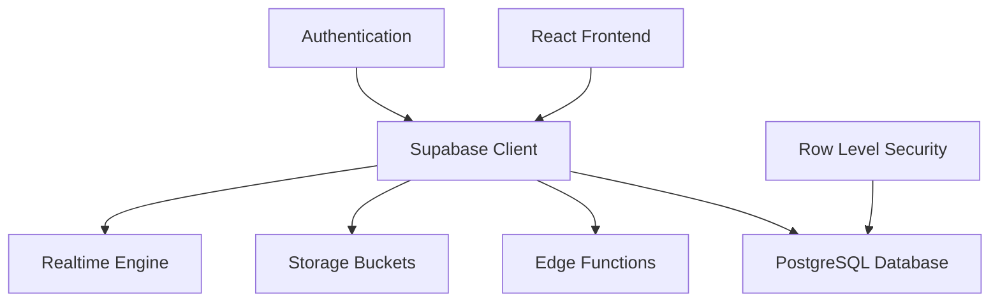

# Documentação Técnica 🛠️

## Arquitetura do Sistema

### Overview da Arquitetura

O sistema segue uma arquitetura moderna baseada em:
- **Frontend**: React SPA (Single Page Application)
- **Backend**: Supabase (PostgreSQL + Edge Functions)
- **Autenticação**: Supabase Auth
- **Storage**: Supabase Storage (para imagens e documentos)
- **Realtime**: WebSockets via Supabase Realtime



## Módulo de Relatório de Medição (v2.1) ⭐

### Arquitetura do Módulo

```mermaid
graph TD
    A[RelatorioMedicao.tsx] --> B[Filtros de Geração]
    A --> C[fetchReportData()]
    C --> D[Equipamentos Logic]
    C --> E[Caminhões Logic]
    D --> F[Cálculo 4 Partes]
    E --> G[Distribuição Proporcional]
    F --> H[RelatorioMedicaoDetalhado]
    G --> H
    H --> I[Export Excel/PDF]
```

### Componentes Principais

#### `RelatorioMedicao.tsx` (1085 linhas)
**⚠️ Este arquivo está muito longo e deveria ser refatorado em componentes menores**

Componente principal que gerencia todo o fluxo do relatório:

```typescript
interface RelatorioMedicaoProps {
  // Sem props específicas - componente de página
}

const RelatorioMedicao: React.FC = () => {
  // Estados principais
  const [vehicleType, setVehicleType] = useState<string>("");
  const [selectedVehicle, setSelectedVehicle] = useState<string>("");
  const [desmobilizacao, setDesmobilizacao] = useState<boolean>(false);
  const [reportData, setReportData] = useState<(EquipmentReportData | TruckReportData)[]>([]);
  const [manutencaoData, setManutencaoData] = useState<ManutencaoEquipmentData | ManutencaoTruckData | null>(null);
  
  // Lógica complexa de cálculos baseada no tipo de veículo
  const fetchReportData = async (): Promise<(EquipmentReportData | TruckReportData)[]> => {
    // Implementação das 4 partes para equipamentos
    // Implementação da distribuição proporcional para caminhões
  };
};
```

**Responsabilidades:**
- Gerenciamento de filtros de geração
- Busca e processamento de dados do Supabase
- Cálculos complexos para ambos os tipos de veículo
- Controle de estados de loading e erro
- Integração com componentes de exportação

#### `RelatorioMedicaoDetalhado.tsx` (424 linhas)
**⚠️ Este arquivo também está longo e deveria ser refatorado**

Componente de renderização do relatório formatado:

```typescript
interface RelatorioMedicaoDetalhadoProps {
  vehicleData: (EquipmentReportData | TruckReportData)[];
  dateRange: { from: Date; to: Date; };
  manutencaoData?: ManutencaoEquipmentData | ManutencaoTruckData | null;
  tipoVeiculo: "Caminhão" | "Equipamento";
}
```

**Funcionalidades:**
- Renderização condicional de tabelas por tipo
- Formatação monetária brasileira
- Cálculo de totais em tempo real
- Campo rastreador editável
- Seção de assinaturas formatada

### Tipos TypeScript Especializados

#### `relatorioMedicao.ts`
```typescript
export interface BaseVehicleReportData {
  id: string;
  label: string;
  tipo_veiculo: string;
  centro_custo: string;
  diasTrabalhados: number;
  totalMensal: number;
  abastecimento: number;
  mediaAbastecimento: number;
  rastreador: number;
}

export interface EquipmentReportData extends BaseVehicleReportData {
  quantidadeHoras: number; // 200 horas fixas
  valorUnitarioHora: number; // R$/h
  horasDisponiveis: number; // Horas efetivas - manutenção
  valorPeriodo: number; // Horas disponíveis * valor unitário
  produtividade: number; // Nova fórmula aplicada
}

export interface TruckReportData extends BaseVehicleReportData {
  qtdDia: number; // Dias trabalhados
  valor: number; // Valor proporcional
  quilometragem: number; // Km do período
}

export interface DescontoData {
  tipoDesconto: string;
  valorUnitario: number;
  qtdHoras?: number; // Para equipamentos
  qtdDias?: number; // Para caminhões
  valor: number;
}
```

### Fórmulas Matemáticas Implementadas

#### Equipamentos (Fórmula de 4 Partes)

```typescript
// 1º parte: Valor Unitário
const valorUnitarioHora = aluguelMensal / 200;

// 2º parte: Desconto de Manutenção
const quantidadeManutencao = (200 / 30) * diasManutencao;
const valorManutencao = quantidadeManutencao * valorUnitarioHora;

// 3º parte: Desconto de Desmobilização (se ativo)
const qtdHorasDesmobilizado = (200 / 30) * diasDesmobilizado;
const valorDesmobilizacao = qtdHorasDesmobilizado * valorUnitarioHora;

// 4º parte: Distribuição das Horas Restantes
const horasRestantes = 200 - totalHorasDescontadas;
const horasDisponiveis = (horasRestantes / totalDiasOperando) * diasCentroCusto;
const valorPeriodo = horasDisponiveis * valorUnitarioHora;

// Nova Fórmula de Produtividade
const produtividade = (totalHorimetrosPeriodo / horasRestantes) * horasDisponiveis;
```

#### Caminhões (Nova Lógica com Descontos)

```typescript
// 1º parte: Valor Diário
const valorDiarioAluguel = aluguelMensal / 30;

// 2º parte: Descontos
const valorDescontoManutencao = valorDiarioAluguel * diasManutencao;
const valorDescontoDesmobilizacao = valorDiarioAluguel * diasDesmobilizado;

// 3º parte: Valor Restante
const valorRestante = aluguelMensal - totalDescontos;
const valorDiarioParaDivisao = valorRestante / totalDiasOperando;

// 4º parte: Valor por Centro de Custo
const valorCentroCusto = valorDiarioParaDivisao * diasCentroCusto;
```

### Queries Otimizadas

#### Busca de Apontamentos Operacionais
```typescript
const { data: operandoData, error } = await supabase
  .from("bd_registro_apontamento_cam_equipa")
  .select(`
    caminhao_equipamento_id,
    centro_custo_id(id, nome_centro_custo, codigo_centro_custo),
    data,
    horimetro_inicial,
    horimetro_final,
    abastecimento,
    situacao,
    bd_caminhoes_equipamentos!inner(
      id, frota, numero_frota, placa, modelo, tipo_veiculo, aluguel
    )
  `)
  .eq("caminhao_equipamento_id", selectedVehicle)
  .gte("data", fromDate)
  .lte("data", toDate)
  .in("situacao", ["Operando", "Disponível"])
  .not("centro_custo_id", "is", null)
  .order("data", { ascending: true });
```

#### Busca de Manutenção para Descontos
```typescript
const { data: manutencaoData, error } = await supabase
  .from("bd_registro_apontamento_cam_equipa")
  .select("data, situacao")
  .eq("caminhao_equipamento_id", selectedVehicle)
  .gte("data", fromDate)
  .lte("data", toDate)
  .eq("situacao", "Em Manutenção")
  .order("data", { ascending: true });
```

## Tratamento de Timezone e Datas

### Função Central de Formatação

O sistema utiliza uma função centralizada para formatação de datas brasileiras:

```typescript
// utils/timezoneUtils.ts
export const formatBrazilianDateForDisplay = (dateString: string | undefined): string => {
  if (!dateString) return 'N/A';
  
  try {
    const date = new Date(dateString);
    if (isNaN(date.getTime())) {
      return 'Data inválida';
    }
    
    // Força timezone brasileiro para exibição
    const brazilDate = new Date(date.toLocaleString("en-US", {timeZone: "America/Sao_Paulo"}));
    return format(brazilDate, 'dd/MM/yyyy', { locale: ptBR });
  } catch (error) {
    console.error('Erro ao formatar data:', error);
    return 'Erro na formatação';
  }
};

export const formatBrazilianDateToString = (date: Date): string => {
  const year = date.getFullYear();
  const month = String(date.getMonth() + 1).padStart(2, '0');
  const day = String(date.getDate()).padStart(2, '0');
  return `${year}-${month}-${day}`;
};
```

### Padrão de Uso
- **SEMPRE** use `formatBrazilianDateForDisplay` para exibir datas
- **NUNCA** use `format` do date-fns diretamente em componentes
- Para cálculos, use as funções utilitárias do `timezoneUtils.ts`

## Sistema de Exportação (v2.1)

### Excel com Múltiplas Abas

```typescript
// lib/excel.ts
export const downloadRelatorioMedicaoExcel = (
  reportData: (EquipmentReportData | TruckReportData)[],
  manutencaoData: ManutencaoEquipmentData | ManutencaoTruckData | null,
  vehicleDetails: VehicleInfo,
  dateRange: { from: Date; to: Date },
  tipoVeiculo: string
) => {
  const workbook = XLSX.utils.book_new();
  
  // Aba 1: Relatório Principal
  const mainSheetData = generateMainReportData(reportData, manutencaoData, tipoVeiculo);
  const mainSheet = XLSX.utils.aoa_to_sheet(mainSheetData);
  XLSX.utils.book_append_sheet(workbook, mainSheet, "Relatório Principal");
  
  // Aba 2: Detalhamento de Descontos
  if (manutencaoData && manutencaoData.valor > 0) {
    const discountSheetData = generateDiscountReportData(manutencaoData, tipoVeiculo);
    const discountSheet = XLSX.utils.aoa_to_sheet(discountSheetData);
    XLSX.utils.book_append_sheet(workbook, discountSheet, "Descontos");
  }
  
  // Aba 3: Resumo por Centro de Custo
  const summarySheetData = generateSummaryReportData(reportData);
  const summarySheet = XLSX.utils.aoa_to_sheet(summarySheetData);
  XLSX.utils.book_append_sheet(workbook, summarySheet, "Resumo");
  
  // Aplicar formatação
  applyExcelFormatting(mainSheet, discountSheet, summarySheet);
  
  // Download
  const fileName = `Relatorio_Medicao_${vehicleDetails.label.replace(/[^a-zA-Z0-9]/g, '_')}_${format(dateRange.from, 'dd-MM-yyyy')}_${format(dateRange.to, 'dd-MM-yyyy')}.xlsx`;
  XLSX.writeFile(workbook, fileName);
};
```

### PDF Formatado

```typescript
// services/pdfService.ts
export const generateReportPDF = async (
  vehicleName: string,
  periodo: string
) => {
  // Capturar elemento HTML do relatório
  const element = document.getElementById('relatorio-medicao-detalhado');
  
  if (!element) {
    throw new Error('Elemento do relatório não encontrado');
  }
  
  const canvas = await html2canvas(element, {
    scale: 2,
    useCORS: true,
    allowTaint: true,
    logging: false
  });
  
  const imgData = canvas.toDataURL('image/png');
  const pdf = new jsPDF('p', 'mm', 'a4');
  
  const imgWidth = 210;
  const pageHeight = 295;
  const imgHeight = (canvas.height * imgWidth) / canvas.width;
  let heightLeft = imgHeight;
  
  let position = 0;
  
  pdf.addImage(imgData, 'PNG', 0, position, imgWidth, imgHeight);
  heightLeft -= pageHeight;
  
  while (heightLeft >= 0) {
    position = heightLeft - imgHeight;
    pdf.addPage();
    pdf.addImage(imgData, 'PNG', 0, position, imgWidth, imgHeight);
    heightLeft -= pageHeight;
  }
  
  const fileName = `Relatorio_Medicao_${vehicleName.replace(/[^a-zA-Z0-9]/g, '_')}_${periodo}.pdf`;
  pdf.save(fileName);
};
```

## Cálculos de Espessura e Aplicação

### Fórmulas Matemáticas

#### Cálculo de Área
```typescript
const area = comprimento * largura; // em m²
```

#### Cálculo de Espessura
```typescript
const espessura = (massaAplicada / area) / 2.4 * 100; // em cm
// Onde 2.4 é a densidade padrão do asfalto em t/m³
```

#### Cálculo de Espessura Média por Carga
```typescript
const espessuraMedia = (massaTotalCarga / areaTotalDetalhes) / 2.4 * 100;
```

### Validações Implementadas
- Massa aplicada não pode exceder massa remanescente
- Área deve ser maior que zero
- Espessura deve estar entre limites técnicos (0.5cm - 15cm)
- Temperatura do asfalto entre 120°C e 180°C

### Status de Espessura
```typescript
export const getEspessuraCalculadaStatus = (espessura: number): 'success' | 'warning' | 'error' => {
  if (espessura >= 3 && espessura <= 7) return 'success';
  if (espessura >= 2 && espessura < 3) return 'warning';
  if (espessura > 7 && espessura <= 10) return 'warning';
  return 'error';
};
```

## Estrutura de Pastas Detalhada

### `/src/components/relatorio-medicao/` (NOVO)

```typescript
├── RelatorioMedicaoDetalhado.tsx      # Componente principal do relatório
├── RelatorioMedicaoDescontos.tsx      # Seção de descontos (não utilizado atualmente)
├── RelatorioMedicaoTabelaServicos.tsx # Tabela de serviços (não utilizado atualmente)
├── RelatorioMedicaoPlaceholder.tsx    # Estado inicial
├── RelatorioMedicaoLoadingState.tsx   # Estado de carregamento
└── RelatorioMedicaoEmptyState.tsx     # Estado vazio
```

### `/src/types/`

```typescript
├── relatorioMedicao.ts   # Tipos específicos do relatório (NOVO)
├── centroCusto.ts        # Tipos de centro de custo
├── funcionario.ts        # Tipos de funcionários
└── veiculo.ts           # Tipos de veículos
```

### `/src/lib/`

```typescript
├── excel.ts             # Funções de exportação Excel (ATUALIZADO)
├── debug.ts             # Funções de debug
└── utils.ts             # Utilitários gerais
```

### `/src/services/`

```typescript
├── pdfService.ts        # Serviço de geração de PDF (NOVO)
├── funcionarioService.ts # Serviços de RH
└── veiculoService.ts    # Serviços de veículos
```

## Principais Componentes React

### Hook Personalizado para Relatório de Medição

```typescript
// hooks/useRelatorioMedicao.ts (SUGESTÃO PARA REFATORAÇÃO)
export const useRelatorioMedicao = () => {
  const [vehicleType, setVehicleType] = useState<string>("");
  const [selectedVehicle, setSelectedVehicle] = useState<string>("");
  const [desmobilizacao, setDesmobilizacao] = useState<boolean>(false);
  const [dateRange, setDateRange] = useState<DateRange | undefined>();
  
  const { data: reportData, isLoading, error } = useQuery({
    queryKey: ['relatorio-medicao', selectedVehicle, dateRange],
    queryFn: () => fetchReportData(selectedVehicle, dateRange, desmobilizacao, vehicleType),
    enabled: !!selectedVehicle && !!dateRange?.from && !!dateRange?.to
  });
  
  return {
    // Estados
    vehicleType, setVehicleType,
    selectedVehicle, setSelectedVehicle,
    desmobilizacao, setDesmobilizacao,
    dateRange, setDateRange,
    
    // Dados
    reportData,
    isLoading,
    error,
    
    // Ações
    generateReport: () => {/* lógica de geração */},
    exportToExcel: () => {/* exportação Excel */},
    exportToPDF: () => {/* exportação PDF */}
  };
};
```

### Modal de Detalhes (Padrão Atualizado)
```typescript
// ApontamentoCaminhoesDetailsModal.tsx
const ApontamentoCaminhoesDetailsModal: React.FC<Props> = ({
  isOpen,
  onClose,
  apontamento,
  inspecao,
  isLoading
}) => {
  const isMobile = useIsMobile();
  
  // ✅ Usa formatação centralizada
  const dataFormatada = formatBrazilianDateForDisplay(apontamento.data);
  
  return (
    <Dialog open={isOpen} onOpenChange={onClose}>
      <DialogContent className={cn(
        "sm:max-w-[700px]", 
        isMobile ? "p-3 w-[95vw] mx-auto" : ""
      )}>
        {/* Conteúdo responsivo */}
      </DialogContent>
    </Dialog>
  );
};
```

### Hook de Formulário com Cálculos
```typescript
// useNovoRegistroForm.ts
export const useNovoRegistroForm = (
  entrega: ListaProgramacaoEntrega | null,
  registroCarga: RegistroCarga | null,
  onSuccess?: () => void
) => {
  // Estados para cálculos automáticos
  const [calculatedArea, setCalculatedArea] = useState<number | null>(null);
  const [calculatedEspessura, setCalculatedEspessura] = useState<number | null>(null);
  
  // Cálculo de área automático
  useEffect(() => {
    if (comprimento && largura) {
      const area = comprimento * largura;
      setCalculatedArea(area);
      form.setValue("area_aplicada", area);
    }
  }, [comprimento, largura, form]);
  
  // Cálculo de espessura automático
  useEffect(() => {
    if (calculatedArea && toneladaAplicada && calculatedArea > 0) {
      const espessura = (toneladaAplicada / calculatedArea) / 2.4;
      setCalculatedEspessura(espessura);
      form.setValue("espessura_aplicada", Number(espessura.toFixed(3)));
    }
  }, [calculatedArea, toneladaAplicada, form]);
  
  return {
    form,
    calculatedArea,
    calculatedEspessura,
    // ... outros métodos
  };
};
```

## Hooks Personalizados

### `useAuth.ts`
Gerencia autenticação e sessão do usuário.

```typescript
export const useAuth = () => {
  const [user, setUser] = useState<User | null>(null);
  const [loading, setLoading] = useState(true);
  
  // Métodos de login, logout, etc.
  
  return {
    user,
    loading,
    signIn,
    signOut,
    signUp
  };
};
```

### `useUserPermissions.ts` (ATUALIZADO)
Gerencia permissões e roles do usuário.

```typescript
export const useUserPermissions = () => {
  const { user } = useAuth();
  const [userRoles, setUserRoles] = useState<string[]>([]);
  const [loading, setLoading] = useState(true);
  
  // Buscar roles do usuário
  useEffect(() => {
    const fetchUserRoles = async () => {
      if (!user) return;
      
      const { data: profile } = await supabase
        .from('profiles')
        .select('funcoes')
        .eq('id', user.id)
        .single();
        
      setUserRoles(profile?.funcoes || []);
      setLoading(false);
    };
    
    fetchUserRoles();
  }, [user]);
  
  // Verificações de permissão
  const isSuperAdmin = userRoles.includes('SuperAdm');
  const canAccessRelatorioMedicao = isSuperAdmin || 
    userRoles.includes('AdmLogistica') || 
    userRoles.includes('Encarregado');
  
  return {
    userRoles,
    loading,
    isSuperAdmin,
    canAccessRelatorioMedicao,
    hasRole: (role: string) => userRoles.includes(role)
  };
};
```

## Serviços e APIs

### `funcionarioService.ts`
CRUD completo para funcionários.

```typescript
export const funcionarioService = {
  // Buscar todos os funcionários
  async fetchFuncionarios(filters?: FuncionarioFilters) {
    const { data, error } = await supabase
      .from('bd_funcionarios')
      .select(`
        *,
        empresa:empresa_id(*),
        departamento:departamento_id(*),
        funcao:funcao_id(*),
        centro_custo:centro_custo_id(*)
      `)
      .order('nome_completo');
      
    if (error) throw error;
    return data;
  },
  
  // Criar funcionário
  async createFuncionario(data: FuncionarioFormData) {
    const { data: funcionario, error } = await supabase
      .from('bd_funcionarios')
      .insert(data)
      .select()
      .single();
      
    if (error) throw error;
    return funcionario;
  },
  
  // Atualizar funcionário
  async updateFuncionario(id: string, data: FuncionarioFormData) {
    const { data: funcionario, error } = await supabase
      .from('bd_funcionarios')
      .update(data)
      .eq('id', id)
      .select()
      .single();
      
    if (error) throw error;
    return funcionario;
  },
  
  // Deletar funcionário
  async deleteFuncionario(id: string) {
    const { error } = await supabase
      .from('bd_funcionarios')
      .delete()
      .eq('id', id);
      
    if (error) throw error;
  }
};
```

### `relatorioMedicaoService.ts` (NOVO)
Serviço especializado para relatórios de medição.

```typescript
export const relatorioMedicaoService = {
  // Buscar tipos de veículo disponíveis
  async fetchVehicleTypes(): Promise<string[]> {
    const { data, error } = await supabase
      .from("bd_caminhoes_equipamentos")
      .select("tipo_veiculo")
      .not("tipo_veiculo", "is", null);
        
    if (error) throw error;
    
    const uniqueTypes = [...new Set(data.map(item => item.tipo_veiculo))];
    return uniqueTypes.filter(Boolean);
  },
  
  // Buscar veículos por tipo
  async fetchVehiclesByType(vehicleType: string): Promise<VehicleInfo[]> {
    const { data, error } = await supabase
      .from("bd_caminhoes_equipamentos")
      .select("id, placa, modelo, frota, numero_frota, tipo_veiculo, aluguel, imagem_url")
      .eq("tipo_veiculo", vehicleType);
    
    if (error) throw error;
    
    return data.map(vehicle => ({
      id: vehicle.id,
      tipo_veiculo: vehicle.tipo_veiculo,
      aluguel: parseFloat(vehicle.aluguel || '0'),
      imagem_url: vehicle.imagem_url,
      label: `${vehicle.frota || ""}${vehicle.numero_frota || ""} - ${vehicle.placa || ""} ${vehicle.modelo ? `(${vehicle.modelo})` : ""}`
    }));
  },
  
  // Buscar apontamentos para relatório
  async fetchApontamentosRelatorio(
    vehicleId: string,
    fromDate: string,
    toDate: string,
    situacoes: string[]
  ) {
    const { data, error } = await supabase
      .from("bd_registro_apontamento_cam_equipa")
      .select(`
        caminhao_equipamento_id,
        centro_custo_id(id, nome_centro_custo, codigo_centro_custo),
        data,
        horimetro_inicial,
        horimetro_final,
        abastecimento,
        situacao,
        bd_caminhoes_equipamentos!inner(
          id, frota, numero_frota, placa, modelo, tipo_veiculo, aluguel
        )
      `)
      .eq("caminhao_equipamento_id", vehicleId)
      .gte("data", fromDate)
      .lte("data", toDate)
      .in("situacao", situacoes)
      .not("centro_custo_id", "is", null)
      .order("data", { ascending: true });
      
    if (error) throw error;
    return data;
  }
};
```

## Responsividade e Mobile

### Hook useIsMobile
```typescript
import { useState, useEffect } from "react";

export const useIsMobile = () => {
  const [isMobile, setIsMobile] = useState(false);

  useEffect(() => {
    const checkDevice = () => {
      setIsMobile(window.innerWidth < 768);
    };

    checkDevice();
    window.addEventListener("resize", checkDevice);

    return () => {
      window.removeEventListener("resize", checkDevice);
    };
  }, []);

  return isMobile;
};
```

### Padrão de Componente Responsivo
```typescript
const Component: React.FC = () => {
  const isMobile = useIsMobile();
  
  return (
    <div className={cn(
      "container",
      isMobile ? "p-3 w-[95vw]" : "p-6"
    )}>
      <ScrollArea className={cn(
        "pr-4",
        isMobile ? "h-[55vh] max-h-[400px]" : "h-[400px]"
      )}>
        {/* Conteúdo adaptativo */}
      </ScrollArea>
    </div>
  );
};
```

## Configurações

### `vite.config.ts`
Configuração do Vite para build e desenvolvimento.

```typescript
import { defineConfig } from 'vite';
import react from '@vitejs/plugin-react';
import path from 'path';

export default defineConfig({
  plugins: [react()],
  resolve: {
    alias: {
      '@': path.resolve(__dirname, './src'),
    },
  },
  server: {
    port: 5173,
    host: true
  },
  build: {
    outDir: 'dist',
    sourcemap: true,
    rollupOptions: {
      output: {
        manualChunks: {
          vendor: ['react', 'react-dom'],
          ui: ['@radix-ui/react-dialog', '@radix-ui/react-select'],
          charts: ['recharts'],
          utils: ['date-fns', 'zod']
        }
      }
    }
  }
});
```

### `tailwind.config.ts`
Configuração do Tailwind CSS customizada.

```typescript
import type { Config } from "tailwindcss";

const config: Config = {
  darkMode: ["class"],
  content: [
    './pages/**/*.{ts,tsx}',
    './components/**/*.{ts,tsx}',
    './app/**/*.{ts,tsx}',
    './src/**/*.{ts,tsx}',
  ],
  theme: {
    container: {
      center: true,
      padding: "2rem",
      screens: {
        "2xl": "1400px",
      },
    },
    extend: {
      colors: {
        border: "hsl(var(--border))",
        input: "hsl(var(--input))",
        ring: "hsl(var(--ring))",
        background: "hsl(var(--background))",
        foreground: "hsl(var(--foreground))",
        primary: {
          DEFAULT: "hsl(var(--primary))",
          foreground: "hsl(var(--primary-foreground))",
        },
        secondary: {
          DEFAULT: "hsl(var(--secondary))",
          foreground: "hsl(var(--secondary-foreground))",
        },
        destructive: {
          DEFAULT: "hsl(var(--destructive))",
          foreground: "hsl(var(--destructive-foreground))",
        },
        muted: {
          DEFAULT: "hsl(var(--muted))",
          foreground: "hsl(var(--muted-foreground))",
        },
        accent: {
          DEFAULT: "hsl(var(--accent))",
          foreground: "hsl(var(--accent-foreground))",
        },
        popover: {
          DEFAULT: "hsl(var(--popover))",
          foreground: "hsl(var(--popover-foreground))",
        },
        card: {
          DEFAULT: "hsl(var(--card))",
          foreground: "hsl(var(--card-foreground))",
        },
      },
      borderRadius: {
        lg: "var(--radius)",
        md: "calc(var(--radius) - 2px)",
        sm: "calc(var(--radius) - 4px)",
      },
      keyframes: {
        "accordion-down": {
          from: { height: "0" },
          to: { height: "var(--radix-accordion-content-height)" },
        },
        "accordion-up": {
          from: { height: "var(--radix-accordion-content-height)" },
          to: { height: "0" },
        },
      },
      animation: {
        "accordion-down": "accordion-down 0.2s ease-out",
        "accordion-up": "accordion-up 0.2s ease-out",
      },
    },
  },
  plugins: [require("tailwindcss-animate")],
};

export default config;
```

## Performance e Otimizações

### Otimizações de Bundle
```typescript
// vite.config.ts - Code splitting estratégico
export default defineConfig({
  build: {
    rollupOptions: {
      output: {
        manualChunks: {
          // Vendor chunks
          'react-vendor': ['react', 'react-dom'],
          'router': ['react-router-dom'],
          'query': ['@tanstack/react-query'],
          
          // UI chunks  
          'ui-core': ['@radix-ui/react-dialog', '@radix-ui/react-select'],
          'ui-forms': ['react-hook-form', '@hookform/resolvers'],
          'ui-charts': ['recharts'],
          
          // Utility chunks
          'date-utils': ['date-fns'],
          'validation': ['zod'],
          'supabase': ['@supabase/supabase-js']
        }
      }
    }
  }
});
```

### Memoização de Componentes
```typescript
// Componentes pesados devem ser memoizados
const RelatorioMedicaoDetalhado = React.memo<RelatorioMedicaoDetalhadoProps>(({
  vehicleData,
  dateRange,
  manutencaoData,
  tipoVeiculo
}) => {
  // Lógica complexa aqui
}, (prevProps, nextProps) => {
  // Comparação customizada para evitar re-renders desnecessários
  return (
    prevProps.vehicleData === nextProps.vehicleData &&
    prevProps.dateRange === nextProps.dateRange &&
    prevProps.manutencaoData === nextProps.manutencaoData &&
    prevProps.tipoVeiculo === nextProps.tipoVeiculo
  );
});
```

### Lazy Loading de Rotas
```typescript
// App.tsx
const RelatorioMedicao = lazy(() => import('@/pages/RelatorioMedicao'));
const Dashboard = lazy(() => import('@/pages/Dashboard'));

// Uso com Suspense
<Suspense fallback={<LoadingSpinner />}>
  <Routes>
    <Route path="/relatorio-medicao" element={<RelatorioMedicao />} />
    <Route path="/dashboard" element={<Dashboard />} />
  </Routes>
</Suspense>
```

## Debugging e Monitoramento

### Debug Utilities
```typescript
// lib/debug.ts
export const debugLog = (message: string, data?: any) => {
  if (import.meta.env.DEV) {
    console.log(`[DEBUG] ${message}`, data);
  }
};

export const performanceLog = (name: string, fn: () => any) => {
  if (import.meta.env.DEV) {
    console.time(name);
    const result = fn();
    console.timeEnd(name);
    return result;
  }
  return fn();
};
```

### Error Boundary
```typescript
// components/ErrorBoundary.tsx
export class ErrorBoundary extends React.Component<
  { children: React.ReactNode },
  { hasError: boolean }
> {
  constructor(props: { children: React.ReactNode }) {
    super(props);
    this.state = { hasError: false };
  }

  static getDerivedStateFromError(error: Error) {
    return { hasError: true };
  }

  componentDidCatch(error: Error, errorInfo: React.ErrorInfo) {
    console.error('Error caught by boundary:', error, errorInfo);
  }

  render() {
    if (this.state.hasError) {
      return (
        <div className="flex items-center justify-center min-h-screen">
          <Card>
            <CardHeader>
              <CardTitle>Algo deu errado</CardTitle>
            </CardHeader>
            <CardContent>
              <p>Ocorreu um erro inesperado. Recarregue a página.</p>
            </CardContent>
          </Card>
        </div>
      );
    }

    return this.props.children;
  }
}
```

## Segurança

### Row Level Security (RLS)
```sql
-- Exemplo de política RLS para bd_funcionarios
CREATE POLICY "Users can only see their company employees" ON bd_funcionarios
  FOR ALL TO authenticated
  USING (
    empresa_id IN (
      SELECT empresa_id FROM profiles WHERE id = auth.uid()
    )
  )
  WITH CHECK (
    empresa_id IN (
      SELECT empresa_id FROM profiles WHERE id = auth.uid()
    )
  );
```

### Validação Client-Side
```typescript
// schemas/relatorioMedicao.ts
export const relatorioMedicaoSchema = z.object({
  vehicleType: z.string().min(1, "Tipo de veículo é obrigatório"),
  selectedVehicle: z.string().uuid("Veículo deve ser selecionado"),
  dateRange: z.object({
    from: z.date({ required_error: "Data inicial é obrigatória" }),
    to: z.date({ required_error: "Data final é obrigatória" })
  }).refine(data => data.to >= data.from, {
    message: "Data final deve ser posterior à data inicial"
  }),
  desmobilizacao: z.boolean().optional()
});
```

## Sugestões de Refatoração

### Urgente (Arquivos Longos)
1. **RelatorioMedicao.tsx (1085 linhas)** - Dividir em:
   - `RelatorioMedicaoPage.tsx` - Componente de página
   - `useRelatorioMedicao.ts` - Hook para lógica
   - `RelatorioMedicaoFilters.tsx` - Componente de filtros
   - `RelatorioMedicaoResults.tsx` - Componente de resultados

2. **RelatorioMedicaoDetalhado.tsx (424 linhas)** - Dividir em:
   - `RelatorioMedicaoHeader.tsx` - Cabeçalho
   - `RelatorioMedicaoTable.tsx` - Tabela principal
   - `RelatorioMedicaoDescontos.tsx` - Seção de descontos
   - `RelatorioMedicaoFooter.tsx` - Assinaturas

### Médio Prazo
1. **Criar serviços especializados** para cada módulo
2. **Implementar testes unitários** para cálculos críticos
3. **Adicionar Storybook** para documentação de componentes
4. **Implementar cache Redis** para queries pesadas

### Melhorias de Performance
1. **Implementar virtualization** para tabelas grandes
2. **Adicionar Service Worker** para cache offline
3. **Otimizar images** com lazy loading
4. **Implementar Suspense** para loading states

---

**Versão**: 2.1  
**Última Atualização**: Dezembro 2024  
**Responsável**: Equipe de Desenvolvimento
