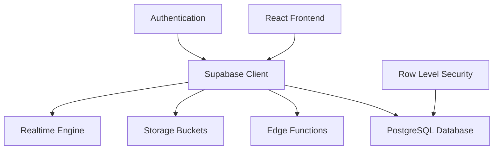

# Documentação Técnica 🛠️

## Arquitetura do Sistema

### Overview da Arquitetura

O sistema segue uma arquitetura moderna baseada em:
- **Frontend**: React SPA (Single Page Application)
- **Backend**: Supabase (PostgreSQL + Edge Functions)
- **Autenticação**: Supabase Auth
- **Storage**: Supabase Storage (para imagens e documentos)
- **Realtime**: WebSockets via Supabase Realtime



## Tratamento de Timezone e Datas

### Função Central de Formatação

O sistema utiliza uma função centralizada para formatação de datas brasileiras:

```typescript
// utils/timezoneUtils.ts
export const formatBrazilianDateForDisplay = (dateString: string | undefined): string => {
  if (!dateString) return 'N/A';
  
  try {
    const date = new Date(dateString);
    if (isNaN(date.getTime())) {
      return 'Data inválida';
    }
    
    // Força timezone brasileiro para exibição
    const brazilDate = new Date(date.toLocaleString("en-US", {timeZone: "America/Sao_Paulo"}));
    return format(brazilDate, 'dd/MM/yyyy', { locale: ptBR });
  } catch (error) {
    console.error('Erro ao formatar data:', error);
    return 'Erro na formatação';
  }
};
```

### Padrão de Uso
- **SEMPRE** use `formatBrazilianDateForDisplay` para exibir datas
- **NUNCA** use `format` do date-fns diretamente em componentes
- Para cálculos, use as funções utilitárias do `timezoneUtils.ts`

### Exemplo de Implementação
```typescript
// ❌ Incorreto - causa problemas de timezone
<dd className="mt-1 text-base">
  {format(new Date(data.data), 'dd/MM/yyyy')}
</dd>

// ✅ Correto - usa formatação centralizada
<dd className="mt-1 text-base">
  {formatBrazilianDateForDisplay(data.data)}
</dd>
```

## Cálculos de Espessura e Aplicação

### Fórmulas Matemáticas

#### Cálculo de Área
```typescript
const area = comprimento * largura; // em m²
```

#### Cálculo de Espessura
```typescript
const espessura = (massaAplicada / area) / 2.4 * 100; // em cm
// Onde 2.4 é a densidade padrão do asfalto em t/m³
```

#### Cálculo de Espessura Média por Carga
```typescript
const espessuraMedia = (massaTotalCarga / areaTotalDetalhes) / 2.4 * 100;
```

### Validações Implementadas
- Massa aplicada não pode exceder massa remanescente
- Área deve ser maior que zero
- Espessura deve estar entre limites técnicos (0.5cm - 15cm)
- Temperatura do asfalto entre 120°C e 180°C

### Status de Espessura
```typescript
export const getEspessuraCalculadaStatus = (espessura: number): 'success' | 'warning' | 'error' => {
  if (espessura >= 3 && espessura <= 7) return 'success';
  if (espessura >= 2 && espessura < 3) return 'warning';
  if (espessura > 7 && espessura <= 10) return 'warning';
  return 'error';
};
```

## Estrutura de Pastas Detalhada

### `/src/components/`

Componentes organizados por domínio funcional:

#### `ui/` - Componentes Base
```typescript
// Componentes do shadcn/ui customizados
├── button.tsx          # Botão base
├── input.tsx           # Input base
├── dialog.tsx          # Modal/Dialog
├── table.tsx           # Tabela
├── form.tsx            # Formulário
├── toast.tsx           # Notificações
└── ...
```

#### `layout/` - Layout e Navegação
```typescript
├── MainLayout.tsx      # Layout principal
├── AppSidebar.tsx      # Sidebar de navegação
├── AppHeader.tsx       # Header da aplicação
└── Navbar.tsx          # Barra de navegação
```

#### `dashboard/` - Dashboard
```typescript
├── StatsCard.tsx       # Cards de estatísticas
├── BarChartCard.tsx    # Gráficos de barras
├── PieChartCard.tsx    # Gráficos de pizza
├── RequisicaoSection.tsx # Seção de requisições
├── RhSection.tsx       # Seção de RH
└── MaquinasSection.tsx # Seção de máquinas
```

#### `funcionarios/` - Gestão de RH
```typescript
├── FuncionarioPage.tsx           # Página principal
├── FuncionarioTable.tsx          # Tabela de funcionários
├── FuncionarioFormModal.tsx      # Modal de formulário
├── FuncionarioDetailsModal.tsx   # Modal de detalhes
├── ImportFuncionariosModal.tsx   # Modal de importação
├── form/
│   ├── FormTabs.tsx              # Abas do formulário
│   ├── PessoalTab.tsx            # Aba dados pessoais
│   ├── ProfissionalTab.tsx       # Aba dados profissionais
│   ├── ContratualTab.tsx         # Aba dados contratuais
│   └── FinanceiroTab.tsx         # Aba dados financeiros
└── DeleteFuncionarioDialog.tsx   # Dialog de exclusão
```

#### `veiculos/` - Gestão de Máquinas
```typescript
├── VeiculoPage.tsx               # Página principal
├── VeiculoTable.tsx              # Tabela de veículos
├── VeiculoFormModal.tsx          # Modal de formulário
├── VeiculoDetailsModal.tsx       # Modal de detalhes
├── form/
│   ├── VeiculoFormTabs.tsx       # Abas do formulário
│   ├── VeiculoDetailsTab.tsx     # Aba detalhes
│   └── VeiculoSpecificationsTab.tsx # Aba especificações
└── table/
    ├── VeiculoTableBody.tsx      # Corpo da tabela
    ├── VeiculoActions.tsx        # Ações da tabela
    └── VeiculoStatusBadge.tsx    # Badge de status
```

#### `apontamento-caminhoes/` - Apontamento de Equipamentos
```typescript
├── ApontamentoCaminhoesTable.tsx        # Tabela de apontamentos
├── ApontamentoCaminhoesForm.tsx         # Formulário de apontamento
├── ApontamentoCaminhoesDetailsModal.tsx # Modal de detalhes
├── ApontamentoCaminhoesFilters.tsx      # Filtros de busca
└── DeleteApontamentoCaminhoesDialog.tsx # Dialog de exclusão
```

#### `requisicoes/` - Gestão de Requisições
```typescript
├── RequisicaoPage.tsx            # Página principal
├── RequisicaoTable.tsx           # Tabela de requisições
├── RequisicaoFormModal.tsx       # Modal de formulário
├── RequisicaoDetailsModal.tsx    # Modal de detalhes
└── ImportRequisicaoModal.tsx     # Modal de importação
```

#### `programacao/` - Programação de Entregas
```typescript
├── ProgramacaoEntregaPage.tsx    # Página principal
├── ProgramacaoEntregaTable.tsx   # Tabela de programação
├── ProgramacaoEntregaFormModal.tsx # Modal de formulário
└── ProgramacaoEntregaDetailsModal.tsx # Modal de detalhes
```

#### `registro-cargas/` - Registro de Cargas
```typescript
├── RegistroCargaForm.tsx         # Formulário principal
├── EntregasTable.tsx             # Tabela de entregas
├── ImageUpload.tsx               # Upload de imagens
├── PesagemSection.tsx            # Seção de pesagem
└── WeightInput.tsx               # Input de peso
```

#### `registro-aplicacao/` - Aplicação de Asfalto
```typescript
├── NovoRegistroAplicacaoModal.tsx # Modal principal
├── RegistroAplicacaoTable.tsx    # Tabela de registros
├── RegistroAplicacaoViewModal.tsx # Modal de visualização
├── form-tabs/
│   ├── DadosIniciaisTab.tsx      # Aba dados iniciais
│   ├── DadosTecnicosTab.tsx      # Aba dados técnicos
│   └── FinalizacaoTab.tsx        # Aba de finalização
└── table/
    ├── EntregaTableRow.tsx       # Linha da tabela
    ├── EntregaActionButtons.tsx  # Botões de ação
    └── EntregaStatusBadge.tsx    # Badge de status
```

### `/src/utils/`

Funções utilitárias especializadas:

```typescript
├── timezoneUtils.ts              # Formatação de datas (CRÍTICO)
├── aplicacaoCalculations.ts      # Cálculos de espessura
├── formatters.ts                 # Formatação de dados
├── validators.ts                 # Validações
├── exportUtils.ts                # Exportação de dados
└── imageUtils.ts                 # Manipulação de imagens
```

## Principais Componentes React

### Modal de Detalhes (Padrão Atualizado)
```typescript
// ApontamentoCaminhoesDetailsModal.tsx
const ApontamentoCaminhoesDetailsModal: React.FC<Props> = ({
  isOpen,
  onClose,
  apontamento,
  inspecao,
  isLoading
}) => {
  const isMobile = useIsMobile();
  
  // ✅ Usa formatação centralizada
  const dataFormatada = formatBrazilianDateForDisplay(apontamento.data);
  
  return (
    <Dialog open={isOpen} onOpenChange={onClose}>
      <DialogContent className={cn(
        "sm:max-w-[700px]", 
        isMobile ? "p-3 w-[95vw] mx-auto" : ""
      )}>
        {/* Conteúdo responsivo */}
      </DialogContent>
    </Dialog>
  );
};
```

### Hook de Formulário com Cálculos
```typescript
// useNovoRegistroForm.ts
export const useNovoRegistroForm = (
  entrega: ListaProgramacaoEntrega | null,
  registroCarga: RegistroCarga | null,
  onSuccess?: () => void
) => {
  // Estados para cálculos automáticos
  const [calculatedArea, setCalculatedArea] = useState<number | null>(null);
  const [calculatedEspessura, setCalculatedEspessura] = useState<number | null>(null);
  
  // Cálculo de área automático
  useEffect(() => {
    if (comprimento && largura) {
      const area = comprimento * largura;
      setCalculatedArea(area);
      form.setValue("area_aplicada", area);
    }
  }, [comprimento, largura, form]);
  
  // Cálculo de espessura automático
  useEffect(() => {
    if (calculatedArea && toneladaAplicada && calculatedArea > 0) {
      const espessura = (toneladaAplicada / calculatedArea) / 2.4;
      setCalculatedEspessura(espessura);
      form.setValue("espessura_aplicada", Number(espessura.toFixed(3)));
    }
  }, [calculatedArea, toneladaAplicada, form]);
  
  return {
    form,
    calculatedArea,
    calculatedEspessura,
    // ... outros métodos
  };
};
```

### Modal de Visualização com Resumo de Aplicação
```typescript
// RegistroAplicacaoViewModal.tsx
export const RegistroAplicacaoViewModal: React.FC<Props> = ({
  registro,
  isOpen,
  onClose,
}) => {
  const [aplicacaoSummary, setAplicacaoSummary] = useState<AplicacaoSummary | null>(null);
  
  // Carregamento de resumo da aplicação
  useEffect(() => {
    const loadAplicacaoSummary = async () => {
      // Cálculos complexos de massa e espessura média
      const espessuraMedia = areaTotalAplicada > 0 ? 
        (massaTotalCarga / areaTotalAplicada) / 2.4 : null;
        
      setAplicacaoSummary({
        totalAplicado,
        massaRemanescente,
        percentualAplicado,
        espessuraMedia,
        areaTotalAplicada,
        massaTotalCarga
      });
    };
    
    loadAplicacaoSummary();
  }, [isOpen, registro.registro_carga_id]);
  
  return (
    <Dialog open={isOpen} onOpenChange={onClose}>
      {/* Modal com seção de progresso */}
      {aplicacaoSummary && (
        <Card className="bg-blue-50 border-blue-200">
          <CardHeader>
            <CardTitle className="text-lg text-blue-800">
              Progresso da Aplicação
            </CardTitle>
          </CardHeader>
          <CardContent>
            <Progress value={aplicacaoSummary.percentualAplicado} />
            {/* Exibição de espessura média quando disponível */}
            {aplicacaoSummary.espessuraMedia !== null && (
              <div>
                <label>Espessura Média</label>
                <p>{aplicacaoSummary.espessuraMedia.toFixed(3)} cm</p>
              </div>
            )}
          </CardContent>
        </Card>
      )}
    </Dialog>
  );
};
```

## Hooks Personalizados

### `useAuth.ts`
Gerencia autenticação e sessão do usuário.

```typescript
export const useAuth = () => {
  const [user, setUser] = useState<User | null>(null);
  const [loading, setLoading] = useState(true);
  
  // Métodos de login, logout, etc.
  
  return {
    user,
    loading,
    signIn,
    signOut,
    signUp
  };
};
```

### `useNovoRegistroForm.ts` (Atualizado)
Gerencia formulário complexo de aplicação com cálculos automáticos e controle de estado.

```typescript
export const useNovoRegistroForm = (
  entrega: ListaProgramacaoEntrega | null,
  registroCarga: RegistroCarga | null,
  onSuccess?: () => void
) => {
  // Estados para cálculos
  const [calculatedArea, setCalculatedArea] = useState<number | null>(null);
  const [calculatedEspessura, setCalculatedEspessura] = useState<number | null>(null);
  const [registroExistente, setRegistroExistente] = useState<any>(null);
  
  // Buscar registro existente
  useEffect(() => {
    const buscarRegistroExistente = async () => {
      if (!entrega?.id) return;
      
      const { data: registros } = await supabase
        .from("bd_registro_apontamento_aplicacao")
        .select("*")
        .eq("lista_entrega_id", entrega.id)
        .order("created_at", { ascending: false })
        .limit(1);
        
      if (registros && registros.length > 0) {
        setRegistroExistente(registros[0]);
        // Preencher formulário com dados existentes
      }
    };
    
    buscarRegistroExistente();
  }, [entrega?.id, form]);
  
  // Cálculos automáticos
  useEffect(() => {
    if (comprimento && largura) {
      const area = comprimento * largura;
      setCalculatedArea(area);
      form.setValue("area_aplicada", area);
    }
  }, [comprimento, largura, form]);
  
  useEffect(() => {
    if (calculatedArea && toneladaAplicada && calculatedArea > 0) {
      const espessura = (toneladaAplicada / calculatedArea) / 2.4;
      setCalculatedEspessura(espessura);
      form.setValue("espessura_aplicada", Number(espessura.toFixed(3)));
    }
  }, [calculatedArea, toneladaAplicada, form]);
  
  return {
    form,
    calculatedArea,
    calculatedEspessura,
    registroExistente,
    onSubmit: form.handleSubmit(onSubmit)
  };
};
```

## Serviços e APIs

### `funcionarioService.ts`
CRUD completo para funcionários.

```typescript
export const funcionarioService = {
  // Buscar todos os funcionários
  async fetchFuncionarios(filters?: FuncionarioFilters) {
    const { data, error } = await supabase
      .from('bd_funcionarios')
      .select(`
        *,
        empresa:empresa_id(*),
        departamento:departamento_id(*),
        funcao:funcao_id(*),
        centro_custo:centro_custo_id(*)
      `)
      .order('nome_completo');
      
    if (error) throw error;
    return data;
  },
  
  // Criar funcionário
  async createFuncionario(data: FuncionarioFormData) {
    const { data: funcionario, error } = await supabase
      .from('bd_funcionarios')
      .insert(data)
      .select()
      .single();
      
    if (error) throw error;
    return funcionario;
  },
  
  // Atualizar funcionário
  async updateFuncionario(id: string, data: FuncionarioFormData) {
    const { data: funcionario, error } = await supabase
      .from('bd_funcionarios')
      .update(data)
      .eq('id', id)
      .select()
      .single();
      
    if (error) throw error;
    return funcionario;
  },
  
  // Deletar funcionário
  async deleteFuncionario(id: string) {
    const { error } = await supabase
      .from('bd_funcionarios')
      .delete()
      .eq('id', id);
      
    if (error) throw error;
  }
};
```

### `apontamentoCaminhoesService.ts` (Atualizado)
Serviço para apontamentos de equipamentos com inspeção.

```typescript
export const apontamentoCaminhoesService = {
  // Buscar apontamentos com inspeções
  async fetchApontamentosComInspecao(filters?: ApontamentoCaminhoesFilters) {
    const { data, error } = await supabase
      .from('bd_registro_apontamento_caminhoes')
      .select(`
        *,
        veiculo:veiculo_id(*),
        operador:operador_id(*),
        centro_custo:centro_custo_id(*),
        inspecao:bd_registro_inspecao_caminhoes!bd_registro_inspecao_caminhoes_apontamento_id_fkey(*)
      `)
      .order('data', { ascending: false });
      
    if (error) throw error;
    return data;
  },
  
  // Buscar detalhes completos
  async fetchApontamentoDetalhes(id: string) {
    const { data: apontamento, error: apontamentoError } = await supabase
      .from('bd_registro_apontamento_caminhoes')
      .select(`
        *,
        veiculo:veiculo_id(*),
        operador:operador_id(*),
        centro_custo:centro_custo_id(*)
      `)
      .eq('id', id)
      .single();
      
    if (apontamentoError) throw apontamentoError;
    
    const { data: inspecao, error: inspecaoError } = await supabase
      .from('bd_registro_inspecao_caminhoes')
      .select('*')
      .eq('apontamento_id', id)
      .single();
      
    return { apontamento, inspecao };
  }
};
```

## Responsividade e Mobile

### Hook useIsMobile
```typescript
import { useState, useEffect } from "react";

export const useIsMobile = () => {
  const [isMobile, setIsMobile] = useState(false);

  useEffect(() => {
    const checkDevice = () => {
      setIsMobile(window.innerWidth < 768);
    };

    checkDevice();
    window.addEventListener("resize", checkDevice);

    return () => {
      window.removeEventListener("resize", checkDevice);
    };
  }, []);

  return isMobile;
};
```

### Padrão de Componente Responsivo
```typescript
const Component: React.FC = () => {
  const isMobile = useIsMobile();
  
  return (
    <div className={cn(
      "container",
      isMobile ? "p-3 w-[95vw]" : "p-6"
    )}>
      <ScrollArea className={cn(
        "pr-4",
        isMobile ? "h-[55vh] max-h-[400px]" : "h-[400px]"
      )}>
        {/* Conteúdo adaptativo */}
      </ScrollArea>
    </div>
  );
};
```

## Configurações

### `vite.config.ts`
Configuração do Vite para build e desenvolvimento.

```typescript
import { defineConfig } from 'vite';
import react from '@vitejs/plugin-react';
import path from 'path';

export default defineConfig({
  plugins: [react()],
  resolve: {
    alias: {
      '@': path.resolve(__dirname, './src'),
    },
  },
  server: {
    port: 5173,
    host: true
  },
  build: {
    outDir: 'dist',
    sourcemap: true
  }
});
```

### `tailwind.config.ts`
Configuração do Tailwind CSS.

```typescript
export default {
  content: ['./index.html', './src/**/*.{js,ts,jsx,tsx}'],
  theme: {
    extend: {
      colors: {
        primary: {
          50: '#eff6ff',
          500: '#3b82f6',
          600: '#2563eb',
          900: '#1e3a8a',
        }
      }
    },
  },
  plugins: [require('@tailwindcss/forms')],
};
```

### Configuração do Supabase

#### Autenticação
```typescript
// supabase/client.ts
export const supabase = createClient(
  process.env.VITE_SUPABASE_URL,
  process.env.VITE_SUPABASE_ANON_KEY,
  {
    auth: {
      autoRefreshToken: true,
      persistSession: true,
      detectSessionInUrl: true
    }
  }
);
```

#### Row Level Security (RLS)
Todas as tabelas utilizam RLS para segurança:

```sql
-- Exemplo de política RLS
CREATE POLICY "Users can view own company data" 
ON bd_funcionarios 
FOR SELECT 
USING (empresa_id IN (
  SELECT empresa_id 
  FROM profiles 
  WHERE id = auth.uid()
));
```

## Padrões de Desenvolvimento Atualizados

### Naming Conventions
- **Componentes**: PascalCase (`FuncionarioForm.tsx`)
- **Hooks**: camelCase começando com 'use' (`useFuncionarioForm.ts`)
- **Serviços**: camelCase terminando em 'Service' (`funcionarioService.ts`)
- **Tipos**: PascalCase (`FuncionarioFormData`)
- **Variáveis**: camelCase (`massaRemanescente`)
- **Utilitários**: camelCase (`formatBrazilianDateForDisplay`)

### Estrutura de Componentes Modal
```typescript
// Imports organizados por categoria
import React, { useState, useEffect } from 'react';
import { Dialog, DialogContent, DialogHeader, DialogTitle } from '@/components/ui/dialog';
import { ScrollArea } from '@/components/ui/scroll-area';
import { useIsMobile } from '@/hooks/use-mobile';
import { cn } from '@/lib/utils';
import { formatBrazilianDateForDisplay } from '@/utils/timezoneUtils';

// Interface de props bem definida
interface ComponentProps {
  isOpen: boolean;
  onClose: () => void;
  data: DataType | null;
  isLoading?: boolean;
}

// Component com responsividade
export const Component: React.FC<ComponentProps> = ({ 
  isOpen,
  onClose,
  data,
  isLoading = false
}) => {
  // Hooks na ordem: estado, custom hooks, effects
  const [localState, setLocalState] = useState('');
  const isMobile = useIsMobile();
  
  useEffect(() => {
    // Lógica de efeito
  }, []);
  
  // Early returns para loading/error
  if (isLoading) {
    return (
      <Dialog open={isOpen} onOpenChange={onClose}>
        <DialogContent>
          <div className="flex justify-center">
            <Loader2 className="h-8 w-8 animate-spin" />
          </div>
        </DialogContent>
      </Dialog>
    );
  }
  
  if (!data) return null;
  
  // Render principal com classes responsivas
  return (
    <Dialog open={isOpen} onOpenChange={onClose}>
      <DialogContent className={cn(
        "sm:max-w-[700px]",
        isMobile ? "p-3 w-[95vw] mx-auto" : ""
      )}>
        <DialogHeader>
          <DialogTitle className="text-center sm:text-left">
            Título
          </DialogTitle>
        </DialogHeader>
        
        <ScrollArea className={cn(
          "pr-4",
          isMobile ? "h-[55vh] max-h-[400px]" : "h-[400px]"
        )}>
          {/* Conteúdo responsivo */}
          <div className="grid grid-cols-1 sm:grid-cols-2 gap-4">
            <div>
              <dt className="text-sm font-medium text-gray-600">Data</dt>
              <dd className="mt-1 text-base">
                {formatBrazilianDateForDisplay(data.data)}
              </dd>
            </div>
          </div>
        </ScrollArea>
      </DialogContent>
    </Dialog>
  );
};
```

### Error Handling Melhorado
```typescript
try {
  const result = await apiCall();
  console.log('Sucesso:', result); // Debug estratégico
  return result;
} catch (error) {
  console.error('Erro detalhado:', error);
  toast({
    title: 'Erro',
    description: error instanceof Error ? error.message : 'Erro inesperado',
    variant: 'destructive'
  });
  throw error; // Re-throw para handling upstream
}
```

### Estado de Loading com Cleanup
```typescript
const [isLoading, setIsLoading] = useState(false);

const handleAction = async () => {
  setIsLoading(true);
  try {
    await action();
    toast({
      title: 'Sucesso',
      description: 'Operação realizada com sucesso'
    });
  } catch (error) {
    // Error handling
  } finally {
    setIsLoading(false); // Sempre executa
  }
};
```

### Validação de Formulários
```typescript
// Schema Zod bem estruturado
const formSchema = z.object({
  data_aplicacao: z.string().min(1, "Data é obrigatória"),
  hora_chegada_local: z.string().min(1, "Hora de chegada é obrigatória"),
  comprimento: z.number().positive("Comprimento deve ser positivo"),
  largura_media: z.number().positive("Largura deve ser positiva"),
  tonelada_aplicada: z.number().positive("Tonelada deve ser positiva"),
}).refine((data) => {
  // Validações cruzadas
  return data.tonelada_aplicada <= massaRemanescente;
}, {
  message: "Massa aplicada excede massa remanescente",
  path: ["tonelada_aplicada"]
});
```

## Performance

### Otimizações Implementadas
- **React.memo()** em componentes pesados de tabela
- **useMemo()** para cálculos de espessura e área
- **useCallback()** para funções de submit e handlers
- **React.lazy()** para lazy loading de páginas
- **Debounce** em campos de busca (300ms)
- **Virtualização** de listas grandes com react-window
- **Code splitting** por rotas e funcionalidades

### Monitoramento e Debug
```typescript
// Debug estratégico com contexto
console.log('🔍 Carregando resumo para carga:', registroCargaId);
console.log('📊 Dados brutos:', { carga, aplicacoes, detalhes });
console.log('📊 Resumo calculado:', {
  massaTotalCarga,
  totalAplicado,
  percentualAplicado: percentualAplicado.toFixed(1) + "%",
  espessuraMedia: espessuraMedia?.toFixed(3) + " cm"
});
console.log('=== SALVAMENTO CONCLUÍDO COM SUCESSO ===');
```

### Métricas de Performance
- **Performance.mark()** para medição de operações críticas
- **React DevTools Profiler** para análise de renders
- **Lighthouse** para métricas de carregamento
- **Bundle analyzer** para otimização de tamanho

## Segurança

### Validações de Input
- Sanitização de uploads de imagem
- Validação de tipos de arquivo
- Limitação de tamanho de arquivo (5MB)
- Escape de SQL injection via Supabase RLS

### Controle de Acesso
```typescript
// Verificação de permissões por módulo
const hasPermission = (module: string, action: string): boolean => {
  return userPermissions.some(p => 
    p.modulo === module && 
    p.acao === action && 
    p.ativo
  );
};

// Proteção de rotas
<RouteProtection 
  requiredModule="aplicacao" 
  requiredAction="visualizar"
>
  <Component />
</RouteProtection>
```

### Auditoria
- Log de todas as ações críticas
- Rastreabilidade completa de modificações
- Backup automático diário
- Retenção de logs por 90 dias

## Testes e Qualidade

### Estratégia de Testes
- **Unit Tests**: Funções utilitárias (timezoneUtils, calculations)
- **Integration Tests**: Hooks e serviços
- **E2E Tests**: Fluxos críticos de aplicação
- **Manual Testing**: Interface responsiva

### Ferramentas de Qualidade
- **ESLint**: Linting de código
- **Prettier**: Formatação consistente
- **TypeScript**: Type checking
- **Husky**: Git hooks para qualidade

---

**Esta documentação é atualizada constantemente. Última atualização: Janeiro 2025**
